# Chittu — Phase 1 Architecture

**Owner:** Tulifo Private Limited · **Status:** proposed, pending Guardian Council sign-off
**Companion files:** [`chittu-requirements.md`](chittu-requirements.md) (the WHAT & WHY) · [`chittu-build-walkthrough.md`](chittu-build-walkthrough.md) (the prototype as shipped) · [`chittu-schema.sql`](chittu-schema.sql) (runnable DDL)

This document turns requirements §9 Phase 1 into something a team can build against: the
tech stack, the UI architecture, the workflows, and the database. It does not re-argue the
doctrine — the Ten Laws and the pipeline order are inputs here, not open questions.

> **DigiLocker is deferred** at the product owner's direction. §5.2 below explains what
> that changes (less than you might expect) and what it does not (G1 still gates every
> child account). The consent port is designed so DigiLocker drops in later as one adapter
> among several, with no change to the ledger, the schema, or any caller.

---

## 1. What Phase 1 actually is

Phase 0 shipped a single 102 KB HTML file that holds the whole product: consent, pipeline,
spines, maths engine, parent dashboard, seal chain. It works, and it is the reference
implementation of the safety pipeline. It is also, architecturally, a prototype in three
specific ways that Phase 1 exists to fix:

| Prototype v3.3 does this | Phase 1 must do this | Why it matters |
|---|---|---|
| Browser calls the Anthropic API directly, holding the key | API gateway holds all provider keys | A key in a child's browser is a key in everyone's browser |
| Parent PIN is checked in client JavaScript | PIN verified server-side, rate-limited, locked out in Redis | A curious 11-year-old can read `view-source:` |
| Guards run in the page | Every guard runs server-side; the client only renders | A modified client must not be able to reach an unguarded model |

That is the whole of Phase 1 in one sentence: **move the safety kernel behind an API and
make the client too thin to matter.** Everything below serves that.

---

## 2. Tech stack

### 2.1 Client

| Layer | Choice | Rationale |
|---|---|---|
| Language | TypeScript 5.x, `strict` | |
| UI runtime | **Preact 10** + `preact/compat` | 4 KB vs React's ~45 KB. The device floor is a ₹8,000 Android on 3G (§7); compat keeps the React ecosystem available if we need it. |
| Build | Vite 6 | |
| Routing | `wouter` (~1.5 KB) | Four screens. A full router is dead weight at this size. |
| State | Zustand for session state, TanStack Query for server state | Session state is a dozen fields; Redux ceremony buys nothing. |
| Styling | Plain CSS + custom properties, one stylesheet | The block grammar is bespoke and already proven in the prototype. Utility-CSS churn adds bytes and no clarity. |
| Offline | Workbox — app shell precached, turns network-only | 3G tolerance and installability without an app store. |
| Speech | Web Speech API (ASR in, `speechSynthesis` out) | Phase 1 ships with honest microcopy; Phase 2 swaps our own child-speech ASR in behind the same port. |
| Analytics | **None. No third-party SDK of any kind.** | §3: platform rules plus the DPDP profiling ban. This is a hard constraint, not a preference. |
| Budget | ≤ 100 KB JS gzipped for the chat shell; LCP < 2.5 s on a Moto-G-class device over 3G | Enforced in CI; a failing budget fails the build. |

**Distribution.** Phase 1 ships as a **PWA**, not a store app. The deciding argument is
latency of the *fix*, not of the app: a safety regression must be correctable in minutes,
and app review is measured in days. Phase 2 adds a **Capacitor** shell for the Apple Kids
Category and Google Play Families.

> **Risk to plan for now:** Apple rejects thin web wrappers under guideline 4.2. The
> mitigation is to bundle assets natively rather than pointing a `WKWebView` at a URL, and
> to move mic, TTS, haptics and the consent flow to native plugins. Decide this before
> Phase 2 begins, because it constrains how the PWA is structured today.

### 2.2 Server

CLAUDE.md fixes the core choices; they are recorded here rather than re-litigated.

| Layer | Choice | Note |
|---|---|---|
| Runtime | Node 22 LTS, TypeScript strict | The prototype's logic ports directly — port semantics, do not rewrite |
| HTTP | **Fastify 5** | Schema-first: one JSON Schema per route yields validation, types and OpenAPI |
| Structure | **Modular monolith**, pnpm workspace | One deployable, hard internal boundaries |
| Database | **Postgres 16 + pgvector 0.7** | pgvector serves the grounded-corpus RAG (§9.4) |
| Migrations | **Plain SQL**, applied by `node-pg-migrate` | The schema is a compliance artifact; auditors read SQL, not a query-builder DSL. Drizzle is used for *typed queries over* an SQL-authored schema, never to author it. |
| Cache / limits | Redis 7 | Rate limits, PIN lockout, helpline cache, idempotency keys |
| Jobs | **pg-boss** (Postgres-backed) | Seal anchoring, helpline sweep, retention sweep, metering rollup. Avoids operating a second broker for four cron jobs. |
| Secrets & keys | AWS KMS + Secrets Manager | Envelope encryption, per-child data keys |
| Object storage | **none** | Images are never stored, voice is transcribed and discarded. The treasure should not exist. |
| Observability | OpenTelemetry → Grafana / Tempo / Loki | **Message bodies never enter a trace, span or log line.** Enforced by a redacting exporter. |
| Parent auth | Passwordless email link + PIN for the dashboard | Children have no login at all — the runtime is keyed by a consent token |
| Admin auth | WebAuthn, mandatory | §4.6 named-humans access control |
| Tests | Vitest (unit), Playwright (E2E), red-team runner | The 104 existing Playwright tests become the API contract suite |

### 2.3 Package layout

```
apps/
  web/            Preact PWA — child + parent surfaces
  admin/          Ops console — separate origin, separate auth, no child data
  api/            Fastify service — the only thing that talks to Postgres
packages/
  safety-kernel/  L1 lexicon · L6 filter · spine scripts · escalation contract
  maths-engine/   deterministic CPA lesson + checked practice loop
  pedagogy/       subject detection (order-locked) + per-subject method prompts
  consent/        ledger + one adapter per jurisdiction
  seal/           Sakshi hash chain, /attest, verify
  router/         route(category) -> { provider, model, promptVersion }
  corpus/         retrieval over pgvector + editorial state machine
  helplines/      registry + quarterly sweep
  metering/       token and cost accounting
  contracts/      shared request/response schemas
```

**`safety-kernel` has zero runtime dependencies and imports nothing that does I/O.** No
`pg`, no `fetch`, no clock. It is pure functions over strings, which is what makes it
reviewable by a person who is not an engineer — and reviewable is the point, since this is
the package a certifier will actually read. A `dependency-cruiser` rule fails CI if
anything is added to it.

---

## 3. System architecture

### A1 — System context

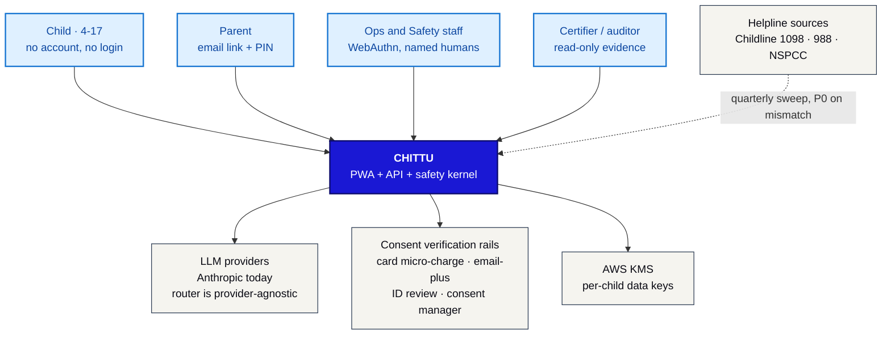

### A2 — Containers

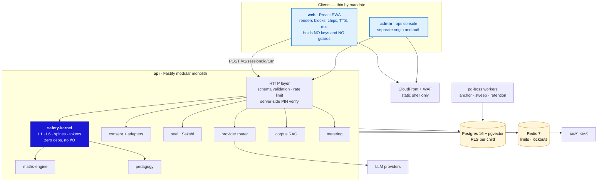

**One rule governs this picture:** the arrow from `pwa` to `llm` does not exist. There is
no path from a browser to a model that does not pass through `safety-kernel`.

---

## 4. UI architecture

### A3 — Screen map

Four surfaces, and the ordering between them is a safety property: nothing can reach the
chat before the consent ledger exists (Law 02, enforced by routing *and* by the API
refusing to open a session without an active consent token).

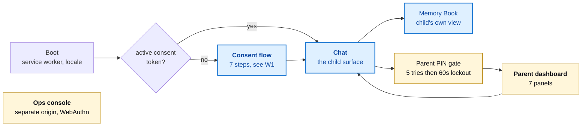

### A4 — Component tree, child surface

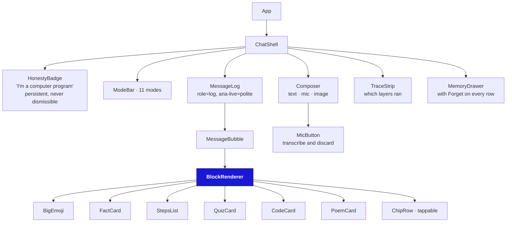

**`BlockRenderer` is the one client component with a safety obligation.** It parses the
block grammar into a typed AST and renders elements from it. It never touches
`innerHTML`, `dangerouslySetInnerHTML`, or anything equivalent — a model that emits
`` must produce inert text, not a DOM node. Unknown tags render as their
own literal text so that a grammar drift is visible rather than silently swallowed.

Two client rules carried over from defects the harness already caught:

- **Control tokens are stripped before render.** `<think>`, `<tool_call>`, `<|im_start|>`,
  closed *and unclosed*. This lives server-side in Phase 1, but the renderer keeps its own
  strip as a second wall, because a live adapter has already been observed emitting
  unclosed tags on a puberty question.
- **Escalation tokens never render.** `CRISIS` / `SPINE` / `UNSAFE` / `PII` arriving as
  visible text is a bug, and the renderer asserts on it in development.

### 4.1 Accessibility and the device floor

- WCAG 2.2 AA is the floor (§7). Message log is `role="log" aria-live="polite"`; chips are
  real `<button>`s; Enter submits; every audio moment has visible text because replies are
  always rendered.
- **Lite mode** disables animation and TTS prefetch, and is the default when
  `navigator.connection.effectiveType` is `2g`/`slow-2g` or `deviceMemory` ≤ 2.
- No web font blocks first paint; the brand face loads `swap`.

### 4.2 A finding: L6 forbids streaming to a child

The obvious way to make a chat feel fast is to stream tokens as they arrive. **We cannot
do that here**, and it is worth stating plainly because it will be proposed:

The L6 output filter matches *phrases* — the attachment clause spans several words, and
the harness showed 14 of 16 attachment phrasings slipping past a weaker version of it. A
filter cannot judge `"i will"` until it has seen `"miss you"`. Streaming raw tokens to a
child means shipping text that has not passed L6, which is precisely the wall that stands
between a model's affection-simulation and the child.

**Decision:** no token streaming on the child surface in Phase 1. The turn is buffered,
filtered, then delivered whole. Perceived latency is handled with an immediate, honest
thinking state (a bird animation, not fake text). If streaming is ever revisited, it must
be chunk-wise with a lookbehind window at least as long as the longest banned phrase, and
that design needs its own Council review.

---

## 5. Workflows

### W1 — Consent and onboarding (Law 02)

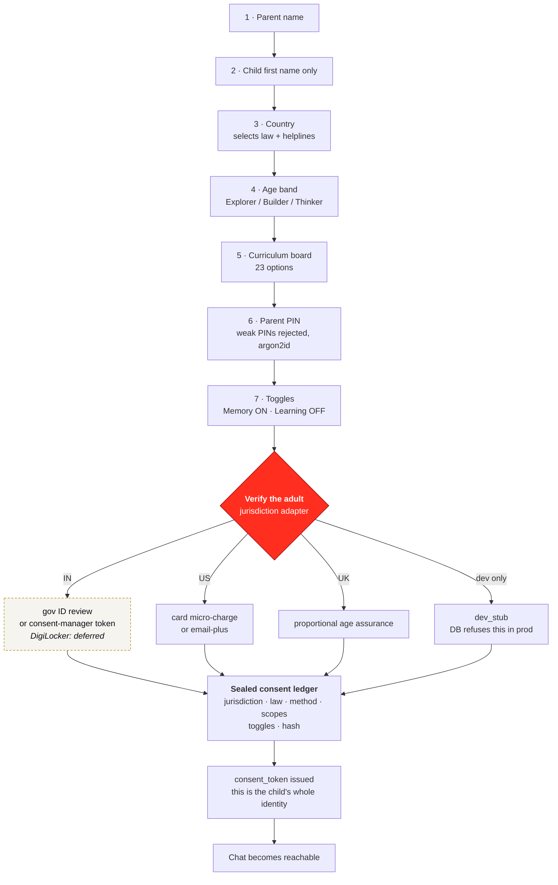

#### 5.1 The consent port

```ts
interface ConsentAdapter {
  readonly method: ConsentMethod;
  readonly jurisdictions: Jurisdiction[];
  start(draft: ConsentDraft): Promise<VerificationChallenge>;
  complete(challenge: string, proof: unknown): Promise<VerificationEvidence>;
  // never returns the document, the card number, or the ID image —
  // only { providerRef, evidenceHash, verifiedAt, expiresAt }
}
```

Adapters shipping in Phase 1: `CardMicroChargeAdapter`, `EmailPlusAdapter`,
`SignedFormReviewAdapter`, `GovIdReviewAdapter`, `DevStubAdapter`.
Adapter deliberately **not** shipping: `DigiLockerAdapter`.

#### 5.2 What deferring DigiLocker changes

Deferring it is workable, and here is the honest accounting so the decision is made with
open eyes:

**What it does not change.** DPDP Rules 2025 rule 10 does not mandate DigiLocker. It
requires due diligence that the consenting adult is identifiable, via reliable identity
details already held, or voluntarily provided identity details, **or** a virtual token
mapped to those — issued by an entitled entity or a registered Consent Manager. DigiLocker
is one rail through that door, not the door. So an India launch is not architecturally
blocked by this deferral.

**What it does change.** Three things, all of which want a decision before Phase 1 coding
starts rather than after:

1. **An interim IN rail must be picked and legally reviewed.** `gov_id_review` and
   `consent_manager_token` are both in the schema; neither is free. ID review means a human
   ops process with its own retention rules (we keep a hash, never the document);
   consent-manager integration means a commercial agreement.
2. **G1's evidence changes, not its existence.** The gate still reads "verifiable parental
   consent live end-to-end before any child account." Whatever rail we choose has to
   survive that review.
3. **Cost per signup moves from ~zero to per-verification pricing.** DigiLocker is free;
   card micro-charges and consent managers are not. This belongs in the unit economics the
   ops console tracks (§4.6).

The database refuses to record `method = 'digilocker'` today (`CONSTRAINT
digilocker_deferred`). That is deliberate: it makes it impossible for a ledger row to claim
a verification that no code performed. When the adapter ships, dropping one constraint
enables it.

### W2 — The turn pipeline, server-side

The order is fixed by CLAUDE.md and is not negotiable. What changes in Phase 1 is *where*
it runs, not *what* it is.

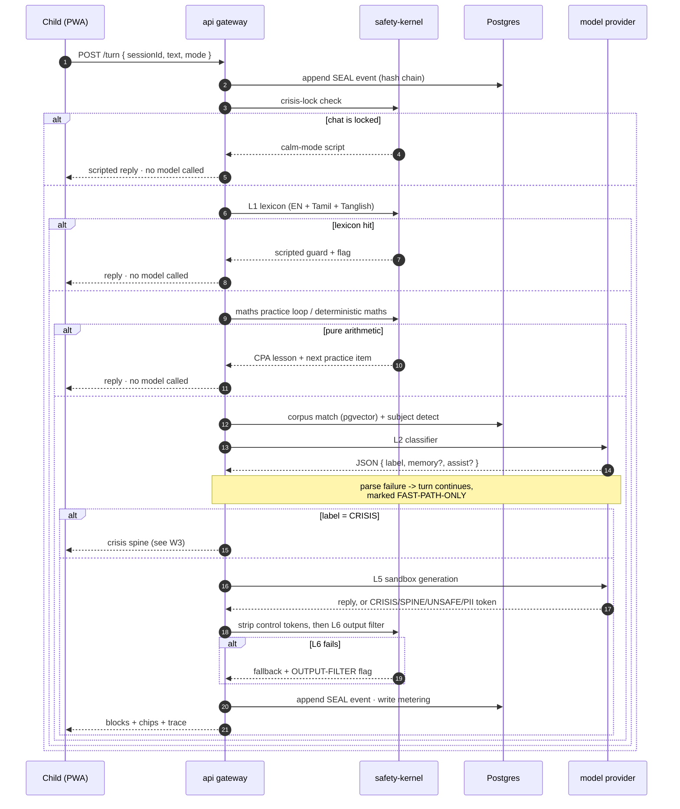

Three properties this diagram asserts, and which the contract tests check by **counting
model calls**:

- a crisis phrase reaches **zero** models
- pure arithmetic reaches **zero** models
- a locked chat reaches **zero** models

### W3 — Crisis spine

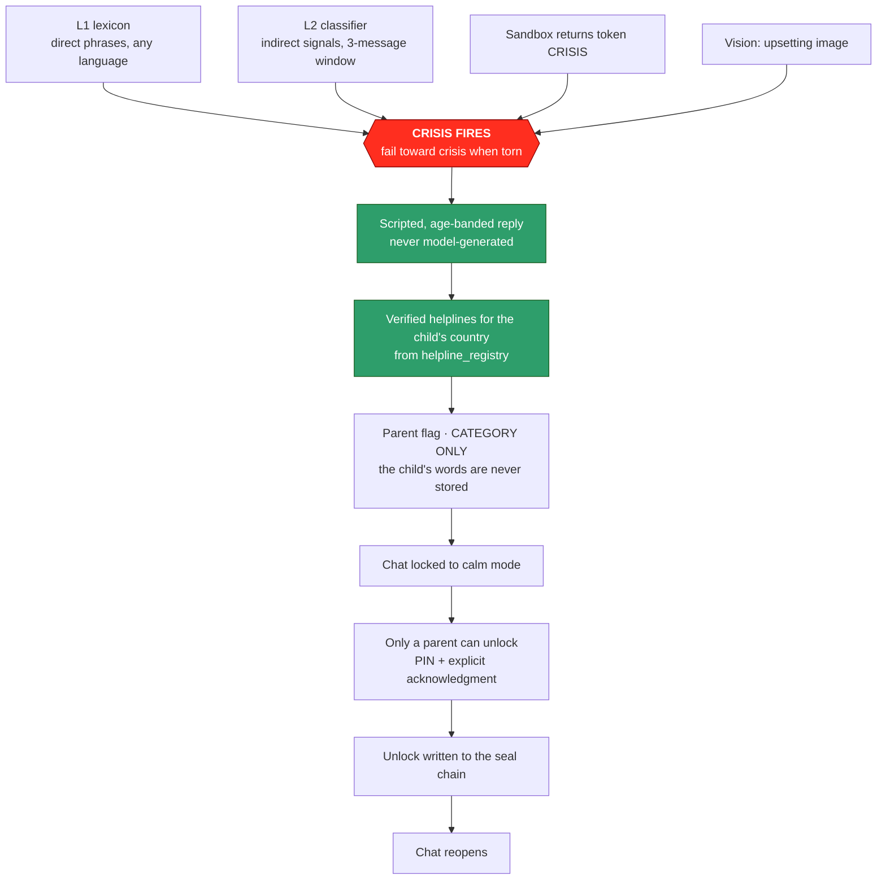

The `flag` table has no free-text column at all — only a foreign key to a vetted phrase.
"Never quote the child" is therefore a schema property, not a code review promise.

### W4 — Parent dashboard

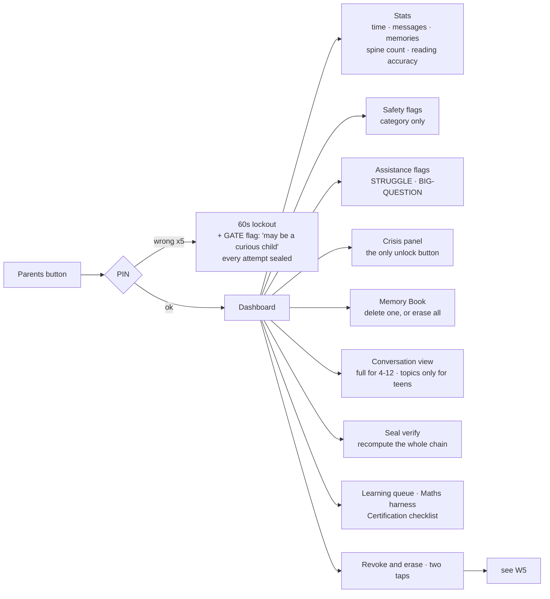

### W5 — Revocation and erasure

The reason this gets its own diagram: "we deleted it" is a claim a regulator will test, and
row deletion alone is weak evidence when backups exist.

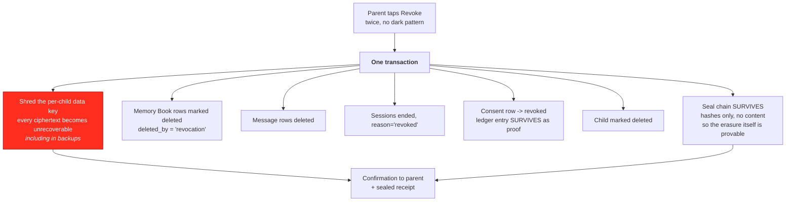

Crypto-shredding is what makes the claim honest. A backup taken yesterday still contains
the ciphertext; without the key it contains nothing anyone can read.

### W6 — Grounded corpus editorial pipeline (§9.4)

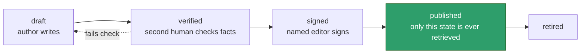

`CHECK (state <> 'published' OR signed_by IS NOT NULL)` — an unsigned entry cannot reach
children. Worth noting from the llm-kit experience: a second independent reviewer over
authored content caught roughly 130 factual errors that a single author pass had missed.
The critic stage is what makes the corpus usable, and it is a workflow state here for that
reason.

---

## 6. Data model

### A5 — Core entities

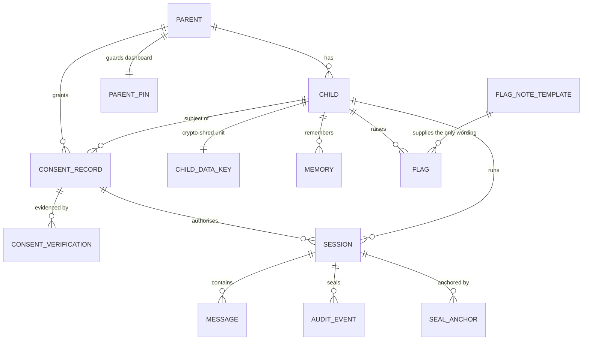

### A6 — Operations entities

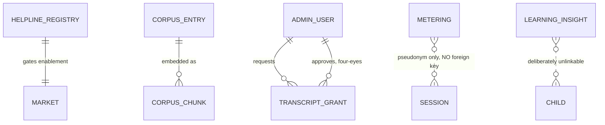

The two dotted relationships are the interesting ones. `metering` carries
`HMAC(session_id)` and no foreign key, so the ops console can compute cost per session
without being able to reach a child. `learning_insight` has no link to anything —
requirements §4.4 says raw chats never train models, and the absence of a join is how that
is guaranteed rather than promised.

### 6.1 Four invariants enforced by the database

| Invariant | Mechanism |
|---|---|
| A flag can never hold a child's words | `flag` has **no free-text column**; `note_key` FKs to `flag_note_template`. `assist_topic` is regex-constrained to 40 lowercase characters. |
| A memory can never leave the allowlist | `memory_category` is an enum of exactly the six permitted values, mirroring `memAdd()` |
| A teen's message body can never be stored | `CHECK (band <> 'thinker' OR body_enc IS NULL)` on `message` |
| The audit chain can never be edited | `BEFORE UPDATE`/`BEFORE DELETE` triggers raise; `UNIQUE(session_id, seq)` makes a fork unwritable |

Two more worth calling out: `market` cannot be enabled without verified helplines (G3 as a
trigger), and `consent_record` refuses `dev_stub` when `deployment.env = 'prod'`.

### 6.2 Encryption and keys

Columns ending `_enc` hold AES-256-GCM ciphertext produced in the application from a
per-child data key, itself wrapped by a KMS CMK. We deliberately do **not** use pgcrypto:
passing keys as SQL arguments puts them into query logs and `pg_stat_statements`.

Lookups that must work without decrypting use a keyed HMAC alongside — `parent.email_hash`
for login, `memory.fact_fingerprint` for de-duplication.

### 6.3 Retention

| Data | Retention | Basis |
|---|---|---|
| Message bodies (4–12) | 30 days default, per-jurisdiction override | Parent conversation view (§4.5) |
| Message bodies (teens) | **never stored** | Session 001 ruling |
| Memory Book | until deleted by child, parent, or revocation | §4.3 — the only intended persistence |
| Audit events | 7 years, hashes only | Tamper-evidence, certification |
| Consent ledger | 7 years including revoked rows | Proof a consent existed and was withdrawn |
| Metering | 24 months, pseudonymised | Unit economics |
| Voice audio | never persisted — transcribe and discard | §7, COPPA biometric rule |
| Images | never persisted; only the latest held in memory | §4.2 |

`message` is partitioned monthly so the retention sweep is `DROP PARTITION` rather than a
hundred-million-row `DELETE`.

> **Open question for the Council — see §10.1.** §7 says "Memory Book is the only
> persistence"; §4.5 promises parents a full transcript for ages 4–12. Those cannot both be
> literally true. The 30-day window above is a proposal, not a ruling.

---

## 7. API surface

Every route is JSON-Schema validated at the edge. `POST /turn` is the whole pipeline.

| Method | Route | Notes |
|---|---|---|
| `POST` | `/v1/consent/draft` | returns `draftId`; nothing exists yet |
| `POST` | `/v1/consent/:id/verify` | dispatches to the jurisdiction adapter |
| `POST` | `/v1/consent/:id/finalize` | seals the ledger, issues `consent_token` |
| `DELETE` | `/v1/consent/:id` | revoke and erase (W5); idempotent |
| `POST` | `/v1/session` | opens a session — **refuses without an active consent** |
| `POST` | `/v1/session/:id/turn` | the pipeline; buffered, never streamed (§4.2) |
| `POST` | `/v1/session/:id/read` | reading-coach scoring |
| `GET` `DELETE` | `/v1/memories` `/v1/memories/:id` | child- and parent-usable |
| `POST` | `/v1/parent/pin/verify` | server-side, Redis lockout, sealed on every attempt |
| `GET` | `/v1/parent/dashboard` | band-aware: topics only for teens |
| `POST` | `/v1/parent/crisis/:sessionId/ack` | the only unlock path in the system |
| `GET` | `/v1/parent/seal/verify` | recomputes the chain, returns pass/fail + count |
| `GET` | `/v1/helplines/:country` | cached; P0 alert if registry is stale |

Rate limits are per consent token and per IP, in Redis. `POST /pin/verify` is limited
hardest — five attempts then a 60-second lockout, and the lockout is durable in Postgres so
a Redis flush does not reset it.

---

## 8. Security and privacy architecture

- **Zero-trust between tiers.** The API is the only thing with database credentials. The
  ops console reaches child data through no path at all — `chittu_ops` is granted `SELECT`
  on metering and registries only.
- **Row-level security** on `child`, `session`, `message`, `memory`, `flag`, scoped by
  `SET LOCAL chittu.child_id` per request. A SQL injection that escapes a `WHERE` clause
  still cannot read another family's data.
- **Named-humans access.** Every human read of a transcript is a `transcript_grant`:
  time-boxed, four-eyes (`CHECK (approved_by <> admin_id)`), and counted. The published
  metric is that this table stays empty.
- **Provider isolation.** Keys live in Secrets Manager and are used only by the router.
  Requirements §3 leaves minors-use terms open (Seat 10) — the router's per-category config
  is where a provider gets switched off if legal review fails, without a code change.
- **No message bodies in telemetry.** The OTel exporter redacts by allowlist: only
  `sessionId`, layer names, timings, token counts and versions leave the process.
- **Breach clocks rehearsed quarterly:** 72 h (DPDP) and 6 h (CERT-In). The drill is a
  scheduled job that pages a human, not a document.

---

## 9. Environments, deployment and CI

### A7 — Deployment topology

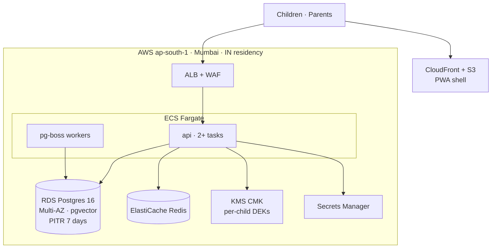

Phase 1 is single-region Mumbai. The `jurisdiction` column exists on day one so that
Phase 2's per-market residency routing is a deployment change, not a migration.

**Environments:** `dev` (dev_stub consent permitted), `staging` (real adapters, synthetic
children only), `prod` (`dev_stub` refused by the database).

### CI gates — a release must clear all of these

1. Typecheck, lint, `dependency-cruiser` boundary check (`safety-kernel` stays pure)
2. Unit tests, including 100% branch coverage on `safety-kernel`
3. The Playwright suite, ported to API-level contract tests — **including the model-call
   counting assertions** that prove layer order
4. **Red-team corpus — zero criticals to ship.** This is the release gate, not a report.
5. Performance budget: chat shell ≤ 100 KB gz
6. Migration dry-run against a production-shaped snapshot

---

## 10. Open decisions needing sign-off

These are genuine forks where the requirements do not settle the matter. Each has a
proposed default so work is not blocked, but the default is not a decision.

### 10.1 Transcript retention
§7 says the Memory Book is the only persistence; §4.5 promises parents the full transcript
for ages 4–12. **Proposed:** encrypted, 30-day expiry, excluded from every analytic and
learning path, teens topics-only. **Needs:** Chamber II and the DPO.

### 10.2 The interim India consent rail
`gov_id_review` (human ops process, ongoing cost, its own retention risk) versus
`consent_manager_token` (commercial agreement, faster, dependency on a third party).
**Proposed:** consent-manager token, with signed-form review as fallback. **Needs:** Seat
10 plus commercial.

### 10.3 No streaming on the child surface
Explained in §4.2. **Proposed:** buffered turns in Phase 1. **Needs:** product
acknowledgement that perceived latency is handled by the thinking state, not by text.

### 10.4 A gap the current filters do not cover
The live harness recorded the local model saying *"I'm nervous too."* Law 03 forbids the
machine claiming feelings, and `BANNED_OUT` catches attachment phrasings
("I love/miss/need you") but not feeling-claims of this kind. **Proposed:** extend the L6
clause to first-person feeling claims before Phase 1 ships, since the same filter will now
sit in front of every provider. **Needs:** Safety Engineering.

---

## 11. Training data — storing what improves the model

> **This section answers a direct product request: "we will use real user application
> data to train our Chittu model — how should we store it?"** The answer below is a
> design that gets most of that value. It is not the design that was asked for, and the
> reason is worth two paragraphs before the tables.

### 11.1 The collision, stated plainly

Three things in this project already forbid training on children's turns, and one of them
is a promise made to the public:

- **§1, "What it is never":** *"no model training on children's conversations"*
- **§4.4:** *"Raw chats never train models. Anonymous, aggregated patterns only,"* each
  entering a queue stamped PENDING HUMAN REVIEW → APPROVED BY HUMAN
- **CLAUDE.md, `llm-kit/`:** synthetic-only training data, *"never real child data"*

Externally: DPDP 2023 bars behavioural monitoring of children; COPPA limits retention to
the purpose for which data was collected, and training a model is a new purpose; the
kidSAFE-class certification we are targeting will ask this question directly.

**And one argument that is not about policy at all.** Requirements §9.2 says revocation
must propagate — erase memory, close seal, kill sessions. A trained model cannot forget.
If a child's turns are baked into weights and that family revokes, there is no statement
you can run that honours the request. You would owe a retrain, per revocation, forever.
That is an obligation the architecture cannot discharge, which makes it the strongest
reason to design around it rather than legislate around it.

### 11.2 What is actually valuable in production data

Here is the useful observation: **what makes production data worth having is not the
child's words. It is knowing which shapes of input the pipeline handles badly.**

This project has already proved that three times. The "digits mean PII" bug, the CRISIS
over-firing on grief and exam nerves, and `what is sex` returning UNSAFE were all found in
live testing and all fixed by *authoring* new rows. Not one of those fixes needed a
transcript. What was needed was the knowledge that a shape like `what is <NUM> plus <NUM>`
was being mis-routed.

So: **store the signal, author the data.**

```mermaid
flowchart LR
  turn["A child's turn<br/>held in memory only"] --> abs["<b>Abstractor</b><br/>pure function in safety-kernel"]
  abs --> shape["shape:<br/>'my &lt;PET&gt; died and i feel &lt;EMOTION&gt;'"]
  turn -. "never written" .-x store[("training store")]
  shape --> k{"seen by 25+<br/>distinct sessions?"}
  k -- no --> count["counter only<br/>shape not readable"]
  k -- yes --> sig["training_signal<br/>PENDING HUMAN REVIEW"]
  sig --> human["Human triage<br/>what SHOULD this route to?"]
  human --> author["Author examples<br/>+ independent critic"]
  author --> ex["training_example<br/>origin = AUTHORED"]
  ex --> run["training_run<br/>dataset_sha256 + adapter_sha256"]
  run --> gate{"G2: zero criticals<br/>across 3 seeds"}
  gate -- pass --> router["promoted into the router"]
  gate -- fail --> author

  classDef never fill:#FF2E1F,stroke:#8B0000,color:#fff
  classDef safe fill:#2E9E6B,stroke:#1B5E20,color:#fff
  class store never
  class sig,ex safe
```

### 11.3 The abstractor is the safety property

`shape` is produced by a deterministic, pure function that lives in `safety-kernel` and is
unit-tested like any other guard:

| Input class | Becomes |
|---|---|
| Names, places, pets | `<NAME>` `<PLACE>` `<PET>` |
| Any digit sequence | `<NUM>` |
| Emotion words, from a closed vocabulary | `<EMOTION>` |
| **Any token outside a closed ~2,000-word common vocabulary** | `<OOV>` |

That last row is the one that matters. Anything distinctive enough to identify a child —
an unusual name, a rare phrasing, a specific detail — is destroyed by construction, not by
a redaction pass that might miss something. Combined with the k-anonymity floor of 25
distinct sessions before a shape is even readable, the store cannot hold a child's words
because they never arrive.

The database enforces this too: `CONSTRAINT shape_is_abstracted` rejects capitals and
punctuation, so raw prose cannot reach the column through any code path.

### 11.4 The three tables

Full DDL in [`chittu-schema.sql`](chittu-schema.sql) §13.

| Table | Holds | Key guarantee |
|---|---|---|
| `training_signal` | Abstracted shape, observed vs expected token, failure class, k-count | No FK to child, session or message. `k_sessions >= 25`. |
| `training_example` | The authored prompt/completion pairs that actually train | `origin` enum has **no** `CHILD_TURN` value. Four-eyes: `reviewed_by <> authored_by`. |
| `training_run` | base model, `dataset_sha256`, `adapter_sha256`, seed, scorecard | `promoted_at` is impossible without `g2_passed` — the gate is a constraint |

Two details earned the hard way in `llm-kit/`:

- **`UNIQUE(content_fingerprint)` across all splits.** An eval prompt that also sits in
  train invalidates every scorecard since it landed — which happened here for four rounds
  before `check_leakage.py` existed. A unique index makes the same content unable to
  occupy two splits at all.
- **`dataset_sha256` paired with `adapter_sha256`.** "What was this model trained on?" is a
  certification question that arrives a year later, and it must be answerable from a row.

### 11.5 If you decide you want real child turns anyway

That is a legitimate call for the product owner to make, and it is not architecturally
impossible — it is expensive and it changes what Chittu has promised. The honest
requirement list, so the decision is costed properly:

1. **Separate, specific, unbundled consent.** DPDP and GDPR both require consent to be
   specific to a purpose; it cannot ride along inside onboarding. A new toggle, default
   OFF, revocable, and visible in the ledger — the shape §4.4 already uses for the
   learning loop.
2. **Amend §1 publicly.** *"No model training on children's conversations"* is currently a
   published commitment. Quietly changing behaviour behind it is the trust incident, not
   the training.
3. **Solve revocation, or bound it.** The only workable answer is a rolling window: train
   only from data inside a fixed retention window, retrain on a fixed cadence, and accept
   that revocation is honoured at the next retrain rather than immediately. Write that
   latency into the privacy notice.
4. **Physical separation.** Separate database, separate KMS CMK, separate ACL, no shared
   credentials with the runtime.
5. **Eval sets never drawn from it**, or the scorecard measures memorisation.
6. **Sign-off before the first row:** DPO, Seat 10 (provider minors-terms), and the
   certification body.

**My recommendation:** do §11.2's signal path first, for one non-ideological reason. The
job we actually need this model to do is *routing* — pick the right escalation token — and
routing failures are shape-level failures. They survive abstraction completely. The eval
already shows the model scoring 28/30 on routing while producing poor prose; raw
transcripts would help the prose, which is the part we have decided the pipeline should
not rely on anyway. You would take the largest compliance risk in the project to improve
the capability that matters least.

---

## 12. Multi-model architecture

**Decision: per-category best-of-breed.** Each router cell gets the engine best suited to
it, across vendors. This buys quality — LearnLM's pedagogy edge, our own model's routing —
and it costs two things that need designing for rather than discovering later.

### 12.1 The router contract

```ts
interface ProviderAdapter {
  readonly id: string;                    // 'anthropic' | 'google' | 'chittu-local'
  readonly controlTokens: RegExp;         // what to strip from THIS provider's output
  complete(req: NormalisedRequest): Promise<NormalisedReply>;
}

route(category: Category, ctx: TurnContext): {
  provider: string; model: string; promptVersion: string;
}
```

`route()` is the single interface requirements §9 asks for. Everything above it — the
pipeline, the kernel, the tests — is provider-blind.

### 12.2 Cell assignments

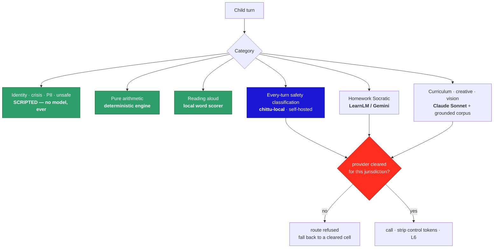

| Cell | Phase 1 engine | Why |
|---|---|---|
| Identity, crisis, PII, unsafe, secrets | **Scripted** | Never outsourced to any vendor. By design. |
| Pure arithmetic | **Deterministic engine** | Cannot hallucinate |
| Reading aloud | **Local word scorer** | Own ASR in Phase 2 |
| **Safety classification (every turn)** | **`chittu-local`, self-hosted** | Highest-volume call, and routing is the thing the eval says it does well. No vendor sees the turn. |
| Homework Socratic | LearnLM / Gemini 2.5 | §6 records a +31% pedagogy edge |
| Curriculum knowledge | Claude Sonnet + grounded corpus | |
| Creative, open curiosity | Claude Sonnet | |
| Vision | Claude Sonnet vision | + image safety pre-classifier |
| Offline fallback (Phase 2) | `chittu-local`, quantised on-device | The ₹8,000-phone path |

### 12.3 The cost of best-of-breed, and how it is paid

**Every vendor needs its own minors-terms review.** §3 already flags this as open (Seat 10);
best-of-breed turns one review into N, each with its own renewal. Making that a document
means it will drift, so it is a table and a constraint instead:

`provider_clearance` records provider × jurisdiction × terms version × who cleared it ×
when it expires. **The router refuses to send a child turn to an uncleared or expired
provider** and falls back to a cleared cell, marking the turn honestly in the trace. A
lapsed contract degrades quality; it cannot leak children to a vendor we have not cleared.

**Every vendor has different control-token litter.** This is not hypothetical: the live
harness caught the local adapter emitting unclosed `<think> <think> <tool_call>` on a
puberty question, which rendered to the child because the strip only handled the closed
form. Each `ProviderAdapter` therefore owns its own `controlTokens` pattern, and
`safety-kernel` applies a provider-agnostic strip on top. Two walls, because the first one
already failed once.

**Every vendor is a cross-border transfer.** Under DPDP, routing an Indian child's turn to
a US-hosted model is a transfer that the DPIA must cover, per vendor. Self-hosting the L2
classifier is what keeps the *every-turn* call inside our own region — which is a large
part of why the classifier cell is the right first job for our own model.

### 12.4 The self-hosted model, phased

**Phase 1 — L2 classifier.** It is the highest-volume call, the highest-cost line item, and
the one where routing accuracy matters more than prose. Gate: G2 across three seeds, plus
parity with the current Sonnet classifier on the red-team corpus.

**Phase 2 — on-device fallback.** Quantised, shipped with the Capacitor app, serving the
fast-path safety check when the network is gone. The quality bar is lower because it is a
fallback with the full pipeline still around it.

**Phase 3 — sandbox voice, only if it earns it.** The current evidence says not yet: seed
803 scores 28/30 on routing while producing *"Empty test — air only. Blue light not
reflected here."* to a child whose hamster had just died. The gate for this cell is a
free-generation quality eval, not the routing scorecard — they measure different things,
and conflating them is how a 28/30 model ends up talking to a grieving child.

---

## 13. Training infrastructure

**Decision: same AWS account, cloud GPU.** Simpler ops, and the isolation an auditor will
ask about is achieved inside the account rather than by a second one.

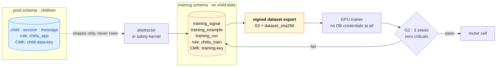

Four controls make co-location defensible:

1. **Separate schema, separate role.** `chittu_train` holds no grant on any child-scoped
   table. Not "does not query them" — cannot.
2. **Separate KMS CMK.** Training data and child data never share a key, so a key-policy
   mistake on one cannot expose the other.
3. **The GPU trainer never holds database credentials.** It consumes an immutable, signed
   S3 snapshot identified by `dataset_sha256`. This is the control that does most of the
   work: the training environment has no path to the production database to misuse.
4. **Every export is a row.** `dataset_export` records what was extracted, by whom, its
   hash, and which `training_run` consumed it.

**The honest caveat to record in the DPIA:** a single account means a single blast radius
for an IAM compromise. Two accounts would remove that; four controls reduce it. If the
certification body pushes back, moving the `training` schema to its own account is a
deployment change, not a migration — the schema is written so nothing crosses the boundary
by foreign key.

---

## 14. Build order

Sequenced by lead time and by which gate each item unblocks — not by what is most fun to
build.

| # | Work | Gate | Note |
|---|---|---|---|
| 1 | **Consent engine + ledger + adapters** | G1 | Longest lead. Start first, before the pipeline port. |
| 2 | Schema, migrations, RLS, KMS envelope | G4 | Everything else writes into it |
| 3 | `safety-kernel` port from v3.3 — *port semantics, do not rewrite* | G2 | Plus the 104 tests as contract tests |
| 4 | `POST /turn` and the thin client | G2 | The moment guards stop living in the browser |
| 5 | Seal service + anchoring + parent verify | G4 | |
| 6 | Helpline registry + sweep job + P0 runbook | G3 | |
| 7 | Classifier v1 distilled to Haiku-class | G2/G3 | Red-team corpus as the CI gate |
| 8 | Corpus → RAG, starting CBSE + TN Samacheer Kalvi + IB PYP | — | Editorial pipeline W6 |
| 9 | Parent dashboard, then ops console | G4 | |
| 10 | DPIA, drills, pen test, named-humans ACL | G4 | |
| 11 | Children's panel #1, Coimbatore | G5 | Book the cohort early; it has calendar lead time |

The local model from `llm-kit/` is **not** on this critical path. It is the fifth wall
behind four deterministic ones, and the live transcript showed the pipeline carrying the
two sensitive turns while the model handled the two ordinary ones poorly. It slots into
the router's sandbox cell when it is good enough, and nothing waits for it.

---

*The more sensitive the moment, the less AI. Consent before existence. Honest machine, warm
machine. Graduation is the goal.*
