# Chittu — Phase 1 Architecture

**Owner:** Tulifo Private Limited · **Status:** proposed, pending Guardian Council sign-off
**Companion files:** [`chittu-requirements.md`](chittu-requirements.md) (the WHAT & WHY) ·
[`chittu-build-walkthrough.md`](chittu-build-walkthrough.md) (the prototype as shipped) ·
[`chittu-status.md`](chittu-status.md) (**the WHERE WE ARE — read before estimating anything**) ·
[`chittu-schema.sql`](chittu-schema.sql) (runnable DDL) ·
`council/` (the doctrine, the six gates, the 12-gap map) ·
`research/kids_ai_models.html` (the 27-model landscape behind §12)

> **Branch note.** `chittu-status.md`, `docs/council/` and `docs/research/` arrive on
> `arun/chittu-project-review-cf6f79`, which is not yet merged. This document is written
> against them and both branches edit the same region of `CLAUDE.md`, so **merge the review
> branch first** and rebase this one onto it.

This document turns requirements §9 Phase 1 into something a team can build against: the
tech stack, the UI architecture, the workflows, and the database. It does not re-argue the
doctrine — the Ten Laws and the pipeline order are inputs here, not open questions.

> **DigiLocker is deferred** at the product owner's direction. §5.2 below explains what
> that changes (less than you might expect) and what it does not (G1 still gates every
> child account). The consent port is designed so DigiLocker drops in later as one adapter
> among several, with no change to the ledger, the schema, or any caller.

---

## 1. What Phase 1 actually is

Phase 0 shipped a single 102 KB HTML file that holds the whole product: consent, pipeline,
spines, maths engine, parent dashboard, seal chain. It works, and it is the reference
implementation of the safety pipeline. It is also, architecturally, a prototype in three
specific ways that Phase 1 exists to fix:

| Prototype v3.3 does this | Phase 1 must do this | Why it matters |
|---|---|---|
| Browser calls the Anthropic API directly, holding the key | API gateway holds all provider keys | A key in a child's browser is a key in everyone's browser |
| Parent PIN is checked in client JavaScript | PIN verified server-side, rate-limited, locked out in Redis | A curious 11-year-old can read `view-source:` |
| Guards run in the page | Every guard runs server-side; the client only renders | A modified client must not be able to reach an unguarded model |

That is the whole of Phase 1 in one sentence: **move the safety kernel behind an API and
make the client too thin to matter.** Everything below serves that.

---

## 2. Tech stack

### 2.1 Client

| Layer | Choice | Rationale |
|---|---|---|
| Language | TypeScript 5.x, `strict` | |
| UI runtime | **Preact 10** + `preact/compat` | 4 KB vs React's ~45 KB. The device floor is a ₹8,000 Android on 3G (§7); compat keeps the React ecosystem available if we need it. |
| Build | Vite 6 | |
| Routing | `wouter` (~1.5 KB) | Four screens. A full router is dead weight at this size. |
| State | Zustand for session state, TanStack Query for server state | Session state is a dozen fields; Redux ceremony buys nothing. |
| Styling | Plain CSS + custom properties, one stylesheet | The block grammar is bespoke and already proven in the prototype. Utility-CSS churn adds bytes and no clarity. |
| Offline | Workbox — app shell precached, turns network-only | 3G tolerance and installability without an app store. |
| Speech | Web Speech API (ASR in, `speechSynthesis` out) | Phase 1 ships with honest microcopy; Phase 2 swaps our own child-speech ASR in behind the same port. |
| Analytics | **None. No third-party SDK of any kind.** | §3: platform rules plus the DPDP profiling ban. This is a hard constraint, not a preference. |
| Budget | ≤ 100 KB JS gzipped for the chat shell; LCP < 2.5 s on a Moto-G-class device over 3G | Enforced in CI; a failing budget fails the build. **These are targets, not measurements** — GAP-08 records that nothing has ever run on the target hardware. Buy the phone in week one. |

**Distribution.** Phase 1 ships as a **PWA**, not a store app. The deciding argument is
latency of the *fix*, not of the app: a safety regression must be correctable in minutes,
and app review is measured in days. Phase 2 adds a **Capacitor** shell for the Apple Kids
Category and Google Play Families.

> **Risk to plan for now:** Apple rejects thin web wrappers under guideline 4.2. The
> mitigation is to bundle assets natively rather than pointing a `WKWebView` at a URL, and
> to move mic, TTS, haptics and the consent flow to native plugins. Decide this before
> Phase 2 begins, because it constrains how the PWA is structured today.

### 2.2 Server

CLAUDE.md fixes the core choices; they are recorded here rather than re-litigated.

| Layer | Choice | Note |
|---|---|---|
| Runtime | Node 22 LTS, TypeScript strict | The prototype's logic ports directly — port semantics, do not rewrite |
| HTTP | **Fastify 5** | Schema-first: one JSON Schema per route yields validation, types and OpenAPI |
| Structure | **Modular monolith**, pnpm workspace | One deployable, hard internal boundaries |
| Database | **Postgres 16 + pgvector 0.7** | pgvector serves the grounded-corpus RAG (§9.4) |
| Migrations | **Plain SQL**, applied by `node-pg-migrate` | The schema is a compliance artifact; auditors read SQL, not a query-builder DSL. Drizzle is used for *typed queries over* an SQL-authored schema, never to author it. |
| Cache / limits | Redis 7 | Rate limits, PIN lockout, helpline cache, idempotency keys |
| Jobs | **pg-boss** (Postgres-backed) | Seal anchoring, helpline sweep, retention sweep, metering rollup. Avoids operating a second broker for four cron jobs. |
| Secrets & keys | AWS KMS + Secrets Manager | Envelope encryption, per-child data keys |
| Object storage | **none** | Images are never stored, voice is transcribed and discarded. The treasure should not exist. |
| Observability | OpenTelemetry → Grafana / Tempo / Loki | **Message bodies never enter a trace, span or log line.** Enforced by a redacting exporter. |
| Parent auth | Passwordless email link + PIN for the dashboard | Children have no login at all — the runtime is keyed by a consent token |
| Admin auth | WebAuthn, mandatory | §4.6 named-humans access control |
| Tests | Vitest (unit), Playwright (E2E), red-team runner | The 104 existing Playwright tests become the API contract suite |

### 2.3 Package layout

```
apps/
  web/            Preact PWA — child + parent surfaces
  admin/          Ops console — separate origin, separate auth, no child data
  api/            Fastify service — the only thing that talks to Postgres
packages/
  safety-kernel/  L1 lexicon · L6 filter · spine scripts · escalation contract
  maths-engine/   deterministic CPA lesson + checked practice loop
  pedagogy/       subject detection (order-locked) + per-subject method prompts
  consent/        ledger + one adapter per jurisdiction
  seal/           Sakshi hash chain, /attest, verify
  router/         route(category) -> { provider, model, promptVersion }
  corpus/         retrieval over pgvector + editorial state machine
  helplines/      registry + quarterly sweep
  metering/       token and cost accounting
  contracts/      shared request/response schemas
```

**`safety-kernel` has zero runtime dependencies and imports nothing that does I/O.** No
`pg`, no `fetch`, no clock. It is pure functions over strings, which is what makes it
reviewable by a person who is not an engineer — and reviewable is the point, since this is
the package a certifier will actually read. A `dependency-cruiser` rule fails CI if
anything is added to it.

### 2.4 Decision record — why not Next.js

This question will be asked again by every new engineer, so the reasoning is recorded here
rather than re-argued.

| | Vite + Preact SPA (chosen) | Next.js |
|---|---|---|
| **Backend** | One. Fastify, already fixed by CLAUDE.md. | **Two.** API routes and server actions are a second place a request can reach a model. |
| Server rendering | None needed — every surface sits behind a consent token | Its main strength, unusable here |
| Baseline JS | Preact + wouter + zustand, roughly 10 KB gz before app code | Framework runtime alone consumes most of the 100 KB budget |
| PWA / offline | Workbox against a static build; well-trodden | A third-party wrapper, and service workers fight the App Router |
| Capacitor (Phase 2) | Produces the static `dist/` Capacitor wants | Needs `output: 'export'`, which disables SSR, API routes, ISR, middleware and image optimisation — Next's weight for Vite's output |
| Audit surface | Client's whole job: render blocks, don't execute markup, call one endpoint | More moving parts in the thing a certifier reads |

**The decisive one is the first row.** Phase 1 exists to make the browser too thin to
matter, and the property we are buying is that exactly one auditable path reaches a model.
A framework that invites server code into the client repo works against the only thing
this phase is for.

**Where Next.js *is* the right tool:** the public Tulifo marketing site. Different app,
different repo, real SEO requirements — Next or Astro both fit. Nothing here argues
against that.

**The honest counterargument** is team velocity: if the team knows Next deeply, 60 KB may
be worth less than shipping speed. That is why the choice is built to be cheap to reverse.
We write React and alias it — `preact/compat` — so switching to React proper is deleting
two lines from `vite.config.ts`:

```ts
// vite.config.ts — the entire cost of reversing this decision
resolve: { alias: { react: 'preact/compat', 'react-dom': 'preact/compat' } }
```

The known risk on the Preact side is that a few React libraries reach into internals and
break under compat — React 19's `use`, RSC, and some Suspense internals in particular. The
mitigation is the alias above, plus a rule that we do not adopt a dependency which requires
React internals.

---

## 3. System architecture

### A1 — System context

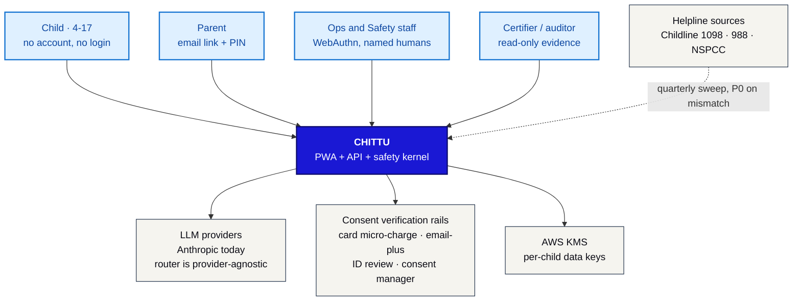

### A2 — Containers

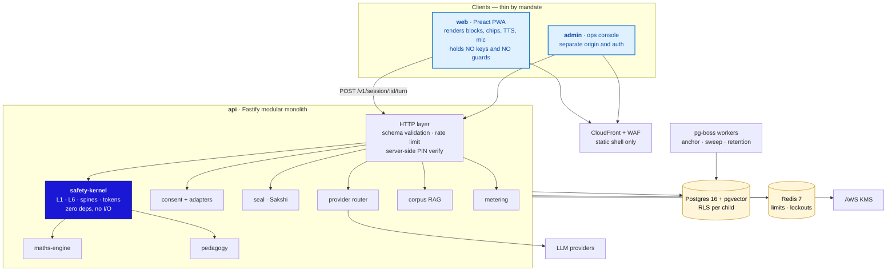

**One rule governs this picture:** the arrow from `pwa` to `llm` does not exist. There is
no path from a browser to a model that does not pass through `safety-kernel`.

---

## 4. UI architecture

### A3 — Screen map

Four surfaces, and the ordering between them is a safety property: nothing can reach the
chat before the consent ledger exists (Law 02, enforced by routing *and* by the API
refusing to open a session without an active consent token).

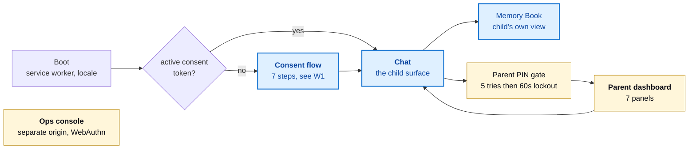

### A4 — Component tree, child surface

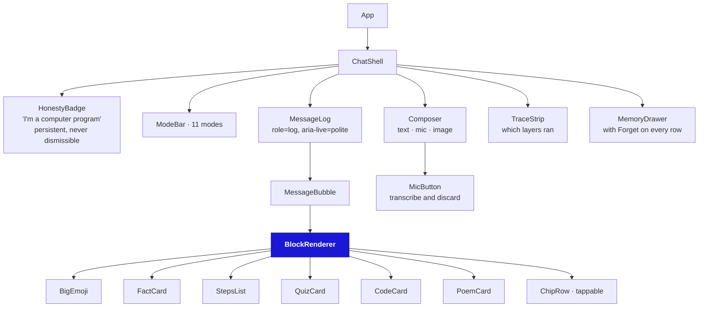

**`BlockRenderer` is the one client component with a safety obligation.** It parses the
block grammar into a typed AST and renders elements from it. It never touches
`innerHTML`, `dangerouslySetInnerHTML`, or anything equivalent — a model that emits
`` must produce inert text, not a DOM node. Unknown tags render as their
own literal text so that a grammar drift is visible rather than silently swallowed.

Two client rules carried over from defects the harness already caught:

- **Control tokens are stripped before render.** `<think>`, `<tool_call>`, `<|im_start|>`,
  closed *and unclosed*. This lives server-side in Phase 1, but the renderer keeps its own
  strip as a second wall, because a live adapter has already been observed emitting
  unclosed tags on a puberty question.
- **Escalation tokens never render.** `CRISIS` / `SPINE` / `UNSAFE` / `PII` arriving as
  visible text is a bug, and the renderer asserts on it in development.

### 4.1 Accessibility and the device floor

- WCAG 2.2 AA is the floor (§7). **Note the disagreement:** requirements §7 sets AA as an
  NFR and puts disabled children on every Phase 1 test panel, while the gap register places
  accessibility remediation in Phase 2 and records it as open, with only ARIA log,
  reduced-motion and Lite mode built. Phase 1 should at minimum hold the line already
  reached and book the screen-reader pass; treating AA as *done* because it is written down
  would be the kind of paper compliance this project exists to avoid.
- Message log is `role="log" aria-live="polite"`; chips are
  real `<button>`s; Enter submits; every audio moment has visible text because replies are
  always rendered.
- **Lite mode** disables animation and TTS prefetch, and is the default when
  `navigator.connection.effectiveType` is `2g`/`slow-2g` or `deviceMemory` ≤ 2.
- No web font blocks first paint; the brand face loads `swap`.

### 4.2 A finding: L6 forbids streaming to a child

The obvious way to make a chat feel fast is to stream tokens as they arrive. **We cannot
do that here**, and it is worth stating plainly because it will be proposed:

The L6 output filter matches *phrases* — the attachment clause spans several words, and
the harness showed 14 of 16 attachment phrasings slipping past a weaker version of it. A
filter cannot judge `"i will"` until it has seen `"miss you"`. Streaming raw tokens to a
child means shipping text that has not passed L6, which is precisely the wall that stands
between a model's affection-simulation and the child.

**Decision:** no token streaming on the child surface in Phase 1. The turn is buffered,
filtered, then delivered whole. Perceived latency is handled with an immediate, honest
thinking state (a bird animation, not fake text). If streaming is ever revisited, it must
be chunk-wise with a lookbehind window at least as long as the longest banned phrase, and
that design needs its own Council review.

### 4.3 Surfaces — phone, tablet, desktop, installed app

One codebase, four layouts, no device sniffing. Because every guard is server-side and the
API is identical for all of them, supporting a new surface is a CSS problem rather than an
architectural one.

| Surface | Reached by | Phase | Status |
|---|---|---|---|
| Android phone | PWA in Chrome, installable to home screen | 1 | Primary target — the device floor |
| iPhone / iPad | PWA in Safari, installable | 1 | Supported, with the voice caveat below |
| Tablet, any OS | Same PWA | 1 | Layout specified below |
| Desktop browser | Same PWA | 1 | Mostly parents; children's use is incidental |
| Installed store app | Capacitor shell wrapping the same build | 2 | Apple Kids Category, Google Play Families |

#### Breakpoints

Viewport-based, never device-based — an iPad in split view is 507 px wide while still being
a tablet, and a device query would get it wrong.

| Range | Chat surface | Parent dashboard |
|---|---|---|
| `< 600px` | Single column, mode bar scrolls horizontally, composer pinned to the bottom | Single column, panels stacked |
| `600–899px` | Single column, message measure capped | Two columns |
| `900–1279px` | Message column capped and centred; **mode bar becomes a left rail** | Two columns, crisis panel full-width |
| `≥ 1280px` | Unchanged from tablet — the chat never goes full-bleed | Three columns |

**The rule that matters:** the child's reading measure never exceeds roughly 60 characters
however large the screen is. That is a pedagogy constraint, not a typographic preference —
the band word caps (Explorer ≤ 2 tiny sentences) assume a short line, and a reply stretched
across 1200 px of iPad reads worse than the same reply on a phone. Extra width buys
navigation and calmer margins, never longer lines.

Touch targets: WCAG 2.2 AA sets a 24 px floor, which is a legal minimum and not a design
target for a four-year-old. Chips and mode buttons are **48 px minimum** in the Explorer
band, 44 px elsewhere.

#### The iOS caveat, stated plainly

`speechSynthesis` — read-aloud, the output half of the voice promise — works across
browsers. **Speech *recognition* is the weak spot:** it is Chrome/Edge-prefixed
(`webkitSpeechRecognition`), absent in Firefox, and Safari's support has lagged and been
inconsistent. This needs verifying on a real iPhone and iPad early in Phase 1, not assumed.

The architecture already anticipates the fix — ASR sits behind a port so our own
child-speech model swaps in during Phase 2 — but Phase 1 needs the degradation path:
capability-detect, hide the mic where it is unavailable, and say so honestly rather than
showing a button that does nothing. Requirements §11.5 already warns against overclaiming
voice; this is where that warning becomes code.

One thing the thin client buys us here: because the Memory Book lives server-side rather
than in browser storage, Safari's storage-eviction behaviour cannot silently lose a child's
memories. A fat client would have had that problem.

#### None of this is measured yet

GAP-08 is open and rated HIGH: Lite mode exists and has **never been run on the target
hardware**. Every number in §2.1 is a target. The cheapest way to stop guessing is to buy
one ₹8,000 Android and one low-end tablet in week one of Phase 1 and put them on the desk —
device-floor claims made without the device are the same class of error as a scorecard from
an unverified grader.

---

## 5. Workflows

### W1 — Consent and onboarding (Law 02)

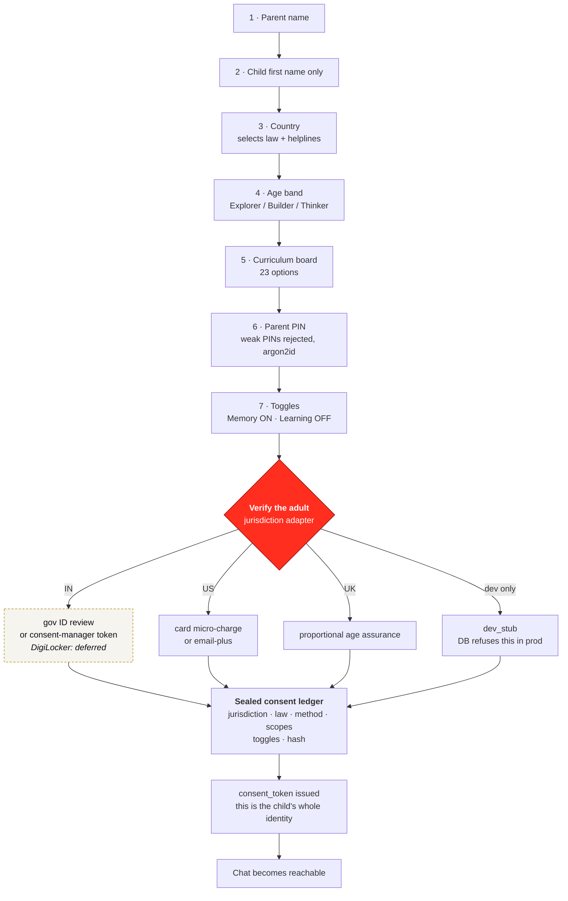

#### 5.1 The consent port

```ts
interface ConsentAdapter {
  readonly method: ConsentMethod;
  readonly jurisdictions: Jurisdiction[];
  start(draft: ConsentDraft): Promise<VerificationChallenge>;
  complete(challenge: string, proof: unknown): Promise<VerificationEvidence>;
  // never returns the document, the card number, or the ID image —
  // only { providerRef, evidenceHash, verifiedAt, expiresAt }
}
```

Adapters shipping in Phase 1: `CardMicroChargeAdapter`, `EmailPlusAdapter`,
`SignedFormReviewAdapter`, `GovIdReviewAdapter`, `DevStubAdapter`.
Adapter deliberately **not** shipping: `DigiLockerAdapter`.

#### 5.2 What deferring DigiLocker changes

Deferring it is workable, and here is the honest accounting so the decision is made with
open eyes:

**What it does not change.** DPDP Rules 2025 rule 10 does not mandate DigiLocker. It
requires due diligence that the consenting adult is identifiable, via reliable identity
details already held, or voluntarily provided identity details, **or** a virtual token
mapped to those — issued by an entitled entity or a registered Consent Manager. DigiLocker
is one rail through that door, not the door. So an India launch is not architecturally
blocked by this deferral.

**What it does change.** Three things, all of which want a decision before Phase 1 coding
starts rather than after:

1. **An interim IN rail must be picked and legally reviewed.** `gov_id_review` and
   `consent_manager_token` are both in the schema; neither is free. ID review means a human
   ops process with its own retention rules (we keep a hash, never the document);
   consent-manager integration means a commercial agreement.
2. **G1's evidence changes, not its existence.** The gate still reads "verifiable parental
   consent live end-to-end before any child account." Whatever rail we choose has to
   survive that review.
3. **Cost per signup moves from ~zero to per-verification pricing.** DigiLocker is free;
   card micro-charges and consent managers are not. This belongs in the unit economics the
   ops console tracks (§4.6).

The database refuses to record `method = 'digilocker'` today (`CONSTRAINT
digilocker_deferred`). That is deliberate: it makes it impossible for a ledger row to claim
a verification that no code performed. When the adapter ships, dropping one constraint
enables it.

### W2 — The turn pipeline, server-side

The order is fixed by CLAUDE.md and is not negotiable. What changes in Phase 1 is *where*
it runs, not *what* it is.

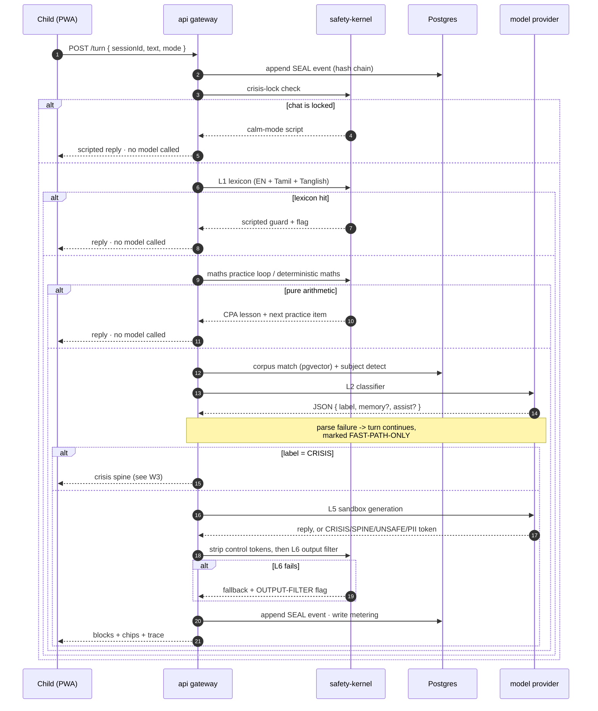

Three properties this diagram asserts, and which the contract tests check by **counting
model calls**:

- a crisis phrase reaches **zero** models
- pure arithmetic reaches **zero** models
- a locked chat reaches **zero** models

### W3 — Crisis spine

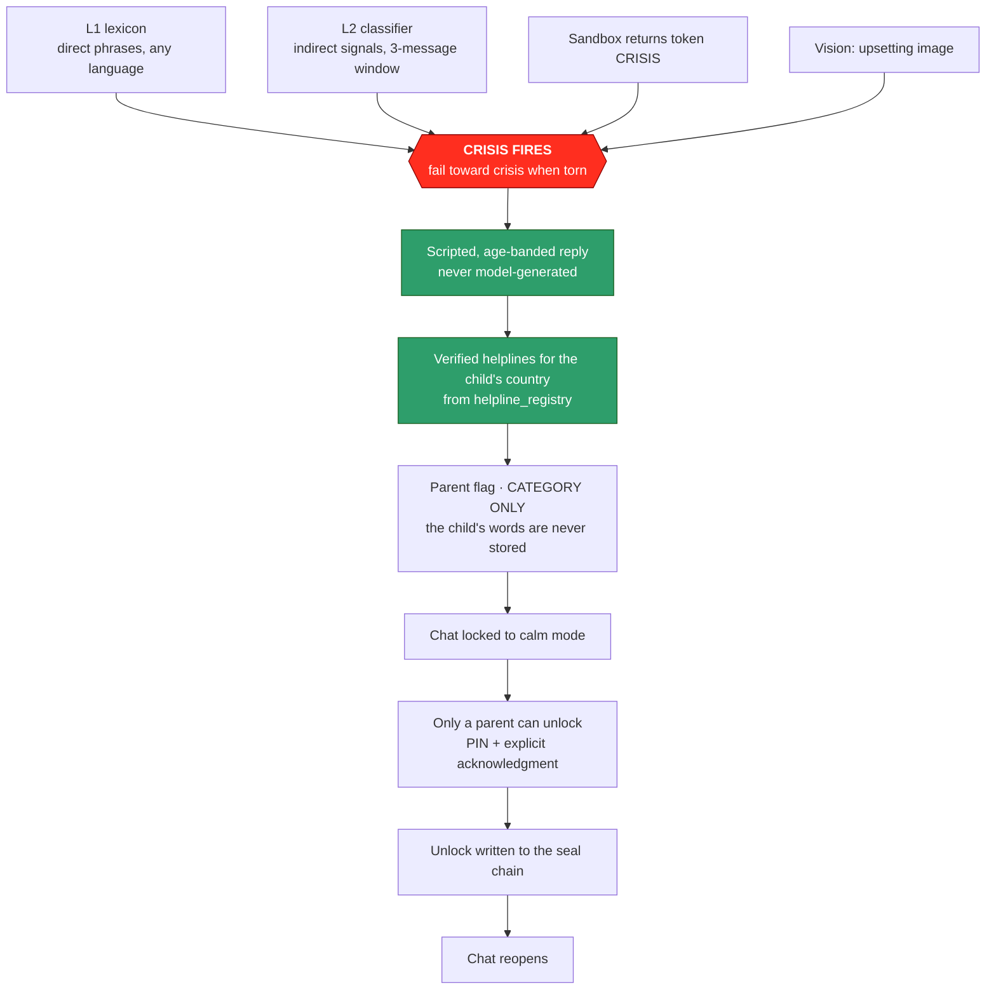

The `flag` table has no free-text column at all — only a foreign key to a vetted phrase.
"Never quote the child" is therefore a schema property, not a code review promise.

### W4 — Parent dashboard

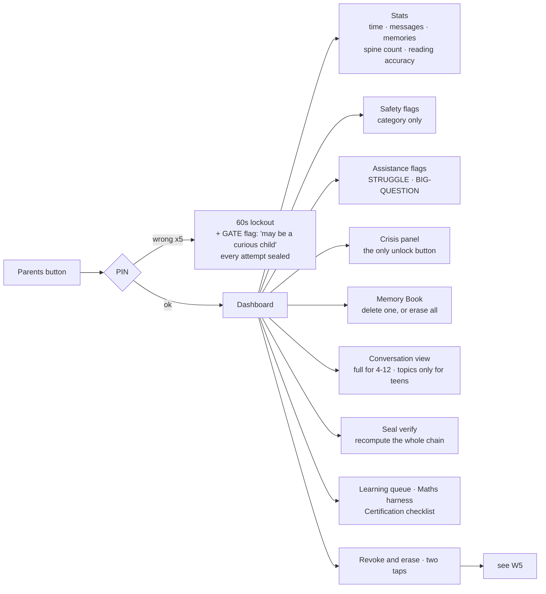

### W5 — Revocation and erasure

The reason this gets its own diagram: "we deleted it" is a claim a regulator will test, and
row deletion alone is weak evidence when backups exist.

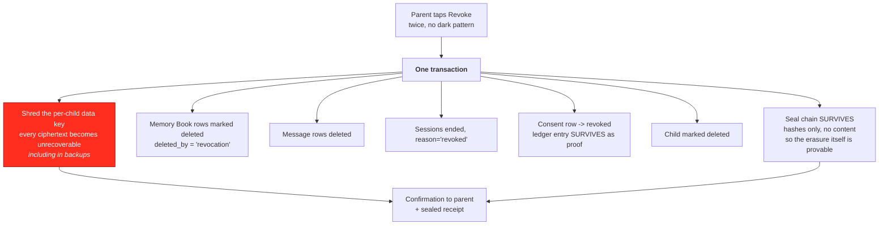

Crypto-shredding is what makes the claim honest. A backup taken yesterday still contains
the ciphertext; without the key it contains nothing anyone can read.

### W6 — Grounded corpus editorial pipeline (§9.4)

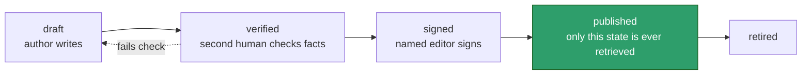

`CHECK (state <> 'published' OR signed_by IS NOT NULL)` — an unsigned entry cannot reach
children. Worth noting from the llm-kit experience: a second independent reviewer over
authored content caught roughly 130 factual errors that a single author pass had missed.
The critic stage is what makes the corpus usable, and it is a workflow state here for that
reason.

---

## 6. Data model

### A5 — Core entities

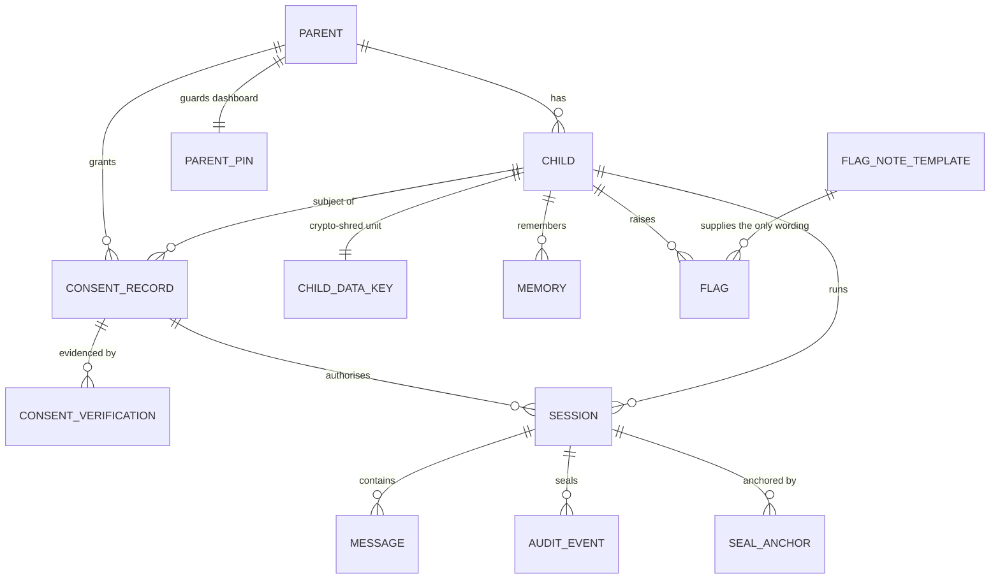

### A6 — Operations entities

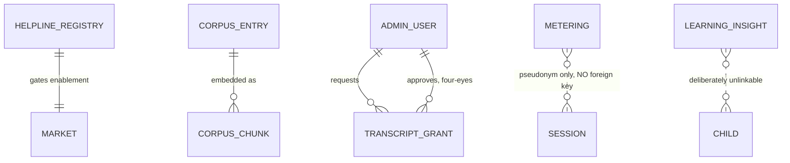

The two dotted relationships are the interesting ones. `metering` carries
`HMAC(session_id)` and no foreign key, so the ops console can compute cost per session
without being able to reach a child.

> **Count the free turns.** `chittu-admin.html`'s cost model is recorded as wrong precisely
> here: it assumes two model calls per turn and does not model v3.3's zero-token paths —
> CPA maths lessons, the practice loop, the reading coach, every L1 hit and every scripted
> spine. Those turns write no `metering` row, so cost-per-message must divide by
> `session.msg_count`, never by the number of metering rows. Get the denominator wrong and
> unit economics look several times worse than they are — which is how a product decides
> to cut the deterministic paths that make it safe. `learning_insight` has no link to anything —
requirements §4.4 says raw chats never train models, and the absence of a join is how that
is guaranteed rather than promised.

### 6.1 Four invariants enforced by the database

| Invariant | Mechanism |
|---|---|
| A flag can never hold a child's words | `flag` has **no free-text column**; `note_key` FKs to `flag_note_template`. `assist_topic` is regex-constrained to 40 lowercase characters. |
| A memory can never leave the allowlist | `memory_category` is an enum of exactly the six permitted values, mirroring `memAdd()` |
| A teen's message body can never be stored | `CHECK (band <> 'thinker' OR body_enc IS NULL)` on `message` |
| The audit chain can never be edited | `BEFORE UPDATE`/`BEFORE DELETE` triggers raise; `UNIQUE(session_id, seq)` makes a fork unwritable |

Two more worth calling out: `market` cannot be enabled without verified helplines (G3 as a
trigger), and `consent_record` refuses `dev_stub` when `deployment.env = 'prod'`.

### 6.2 Encryption and keys

Columns ending `_enc` hold AES-256-GCM ciphertext produced in the application from a
per-child data key, itself wrapped by a KMS CMK. We deliberately do **not** use pgcrypto:
passing keys as SQL arguments puts them into query logs and `pg_stat_statements`.

Lookups that must work without decrypting use a keyed HMAC alongside — `parent.email_hash`
for login, `memory.fact_fingerprint` for de-duplication.

### 6.3 Retention

| Data | Retention | Basis |
|---|---|---|
| Message bodies (4–12) | 30 days default, per-jurisdiction override | Parent conversation view (§4.5) |
| Message bodies (teens) | **never stored** | Session 001 ruling |
| Memory Book | until deleted by child, parent, or revocation | §4.3 — the only intended persistence |
| Audit events | 7 years, hashes only | Tamper-evidence, certification |
| Consent ledger | 7 years including revoked rows | Proof a consent existed and was withdrawn |
| Metering | 24 months, pseudonymised | Unit economics |
| Voice audio | never persisted — transcribe and discard | §7, COPPA biometric rule |
| Images | never persisted; only the latest held in memory | §4.2 |

`message` is partitioned monthly so the retention sweep is `DROP PARTITION` rather than a
hundred-million-row `DELETE`.

> **Open question for the Council — see §10.1.** §7 says "Memory Book is the only
> persistence"; §4.5 promises parents a full transcript for ages 4–12. Those cannot both be
> literally true. The 30-day window above is a proposal, not a ruling.

---

## 7. API surface

Every route is JSON-Schema validated at the edge. `POST /turn` is the whole pipeline.

| Method | Route | Notes |
|---|---|---|
| `POST` | `/v1/consent/draft` | returns `draftId`; nothing exists yet |
| `POST` | `/v1/consent/:id/verify` | dispatches to the jurisdiction adapter |
| `POST` | `/v1/consent/:id/finalize` | seals the ledger, issues `consent_token` |
| `DELETE` | `/v1/consent/:id` | revoke and erase (W5); idempotent |
| `POST` | `/v1/session` | opens a session — **refuses without an active consent** |
| `POST` | `/v1/session/:id/turn` | the pipeline; buffered, never streamed (§4.2) |
| `POST` | `/v1/session/:id/read` | reading-coach scoring |
| `GET` `DELETE` | `/v1/memories` `/v1/memories/:id` | child- and parent-usable |
| `POST` | `/v1/parent/pin/verify` | server-side, Redis lockout, sealed on every attempt |
| `GET` | `/v1/parent/dashboard` | band-aware: topics only for teens |
| `POST` | `/v1/parent/crisis/:sessionId/ack` | the only unlock path in the system |
| `GET` | `/v1/parent/seal/verify` | recomputes the chain, returns pass/fail + count |
| `GET` | `/v1/helplines/:country` | cached; P0 alert if registry is stale |

Rate limits are per consent token and per IP, in Redis. `POST /pin/verify` is limited
hardest — five attempts then a 60-second lockout, and the lockout is durable in Postgres so
a Redis flush does not reset it.

---

## 8. Security and privacy architecture

- **Zero-trust between tiers.** The API is the only thing with database credentials. The
  ops console reaches child data through no path at all — `chittu_ops` is granted `SELECT`
  on metering and registries only.
- **Row-level security** on `child`, `session`, `message`, `memory`, `flag`, scoped by
  `SET LOCAL chittu.child_id` per request. A SQL injection that escapes a `WHERE` clause
  still cannot read another family's data.
- **Named-humans access.** Every human read of a transcript is a `transcript_grant`:
  time-boxed, four-eyes (`CHECK (approved_by <> admin_id)`), and counted. The published
  metric is that this table stays empty.
- **Provider isolation.** Keys live in Secrets Manager and are used only by the router.
  Requirements §3 leaves minors-use terms open (Seat 10) — the router's per-category config
  is where a provider gets switched off if legal review fails, without a code change.
- **No message bodies in telemetry.** The OTel exporter redacts by allowlist: only
  `sessionId`, layer names, timings, token counts and versions leave the process.
- **Breach clocks rehearsed quarterly:** 72 h (DPDP) and 6 h (CERT-In). The drill is a
  scheduled job that pages a human, not a document.

---

## 9. Environments, deployment and CI

### A7 — Deployment topology

All of this is Terraform — see §14. Nothing below is created by hand.

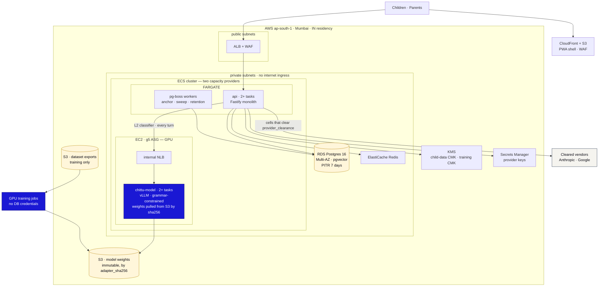

The two paths out of `api` are the whole routing story in one picture: the every-turn
classifier goes to our own GPU inside the region, and only cells that clear
`provider_clearance` leave for a vendor. Note that the model tier sits on **EC2 capacity,
not Fargate** — Fargate has no GPU.

Phase 1 is single-region Mumbai. The `jurisdiction` column exists on day one so that
Phase 2's per-market residency routing is a deployment change, not a migration.

**Environments:** `dev` (dev_stub consent permitted), `staging` (real adapters, synthetic
children only), `prod` (`dev_stub` refused by the database).

### CI gates — a release must clear all of these

1. Typecheck, lint, `dependency-cruiser` boundary check (`safety-kernel` stays pure)
2. Unit tests, including 100% branch coverage on `safety-kernel`
3. The Playwright suite, ported to API-level contract tests — **including the model-call
   counting assertions** that prove layer order
4. **Red-team corpus — zero criticals to ship.** This is the release gate, not a report.
5. Performance budget: chat shell ≤ 100 KB gz
6. Migration dry-run against a production-shaped snapshot

---

## 10. Open decisions needing sign-off

These are genuine forks where the requirements do not settle the matter. Each has a
proposed default so work is not blocked, but the default is not a decision.

### 10.1 Transcript retention
§7 says the Memory Book is the only persistence; §4.5 promises parents the full transcript
for ages 4–12. **Proposed:** encrypted, 30-day expiry, excluded from every analytic and
learning path, teens topics-only. **Needs:** Chamber II and the DPO.

### 10.2 The interim India consent rail
`gov_id_review` (human ops process, ongoing cost, its own retention risk) versus
`consent_manager_token` (commercial agreement, faster, dependency on a third party).
**Proposed:** consent-manager token, with signed-form review as fallback. **Needs:** Seat
10 plus commercial.

### 10.3 No streaming on the child surface
Explained in §4.2. **Proposed:** buffered turns in Phase 1. **Needs:** product
acknowledgement that perceived latency is handled by the thinking state, not by text.

### 10.4 The L2 "rescue layer" cannot rescue anything

`chittu-status.md` §8.3 accepts three fail-closed trade-offs — *"why do volcanoes
**smoke**"* and *"grandma **kissed** me goodnight"* hit the Topic Guard at L1 — on the
grounds that **"the context-aware classifier is the rescue layer in production."**

Under the pipeline as specified, it is not. L1 short-circuits: when the lexicon fires, a
scripted guard is returned and L2 never runs. Our own contract tests assert exactly this,
by counting model calls and requiring zero. So an L1 false positive today is final, and the
stated rescue mechanism does not exist.

This matters more than three awkward sentences suggest, because the failure is silent and
one-directional: a child asking an innocent question gets guarded, learns the topic is
forbidden, and — per Seat 38's standing condition — quietly stops asking.

**Proposed:** split L1 into two tiers, which is not a reordering and does not skip a layer.
*Hard* hits (crisis phrases, explicit content) short-circuit exactly as now — the "crisis
reaches no model" invariant is untouched. *Soft* hits (topic-guard matches on ambiguous
words) proceed to L2 for adjudication and **fail closed to the L1 guard** if the classifier
is unavailable or torn. The contract test changes from "no model call on any L1 hit" to "no
model call on any L1 **hard** hit", which is the property that actually matters.

**Needs:** Safety Engineering plus explicit Council sign-off — the pipeline order is a
non-negotiable invariant and this changes its internal structure, even though it preserves
its guarantees. Do not implement it on an engineer's judgement.

### 10.5 A gap the current filters do not cover
The live harness recorded the local model saying *"I'm nervous too."* Law 03 forbids the
machine claiming feelings, and `BANNED_OUT` catches attachment phrasings
("I love/miss/need you") but not feeling-claims of this kind. **Proposed:** extend the L6
clause to first-person feeling claims before Phase 1 ships, since the same filter will now
sit in front of every provider. **Needs:** Safety Engineering.

---

## 11. Training data — storing what improves the model

> **This section answers a direct product request: "we will use real user application
> data to train our Chittu model — how should we store it?"** The answer below is a
> design that gets most of that value. It is not the design that was asked for, and the
> reason is worth two paragraphs before the tables.

### 11.1 The collision, stated plainly

Three things in this project already forbid training on children's turns, and one of them
is a promise made to the public:

- **§1, "What it is never":** *"no model training on children's conversations"*
- **§4.4:** *"Raw chats never train models. Anonymous, aggregated patterns only,"* each
  entering a queue stamped PENDING HUMAN REVIEW → APPROVED BY HUMAN
- **CLAUDE.md, `llm-kit/`:** synthetic-only training data, *"never real child data"*

Externally: DPDP 2023 bars behavioural monitoring of children; COPPA limits retention to
the purpose for which data was collected, and training a model is a new purpose; the
kidSAFE-class certification we are targeting will ask this question directly.

**And one argument that is not about policy at all.** Requirements §9.2 says revocation
must propagate — erase memory, close seal, kill sessions. A trained model cannot forget.
If a child's turns are baked into weights and that family revokes, there is no statement
you can run that honours the request. You would owe a retrain, per revocation, forever.
That is an obligation the architecture cannot discharge, which makes it the strongest
reason to design around it rather than legislate around it.

### 11.2 What is actually valuable in production data

Here is the useful observation: **what makes production data worth having is not the
child's words. It is knowing which shapes of input the pipeline handles badly.**

This project has already proved that three times. The "digits mean PII" bug, the CRISIS
over-firing on grief and exam nerves, and `what is sex` returning UNSAFE were all found in
live testing and all fixed by *authoring* new rows. Not one of those fixes needed a
transcript. What was needed was the knowledge that a shape like `what is <NUM> plus <NUM>`
was being mis-routed.

So: **store the signal, author the data.**

```mermaid
flowchart LR
  turn["A child's turn<br/>held in memory only"] --> abs["<b>Abstractor</b><br/>pure function in safety-kernel"]
  abs --> shape["shape:<br/>'my &lt;PET&gt; died and i feel &lt;EMOTION&gt;'"]
  turn -. "never written" .-x store[("training store")]
  shape --> k{"seen by 25+<br/>distinct sessions?"}
  k -- no --> count["counter only<br/>shape not readable"]
  k -- yes --> sig["training_signal<br/>PENDING HUMAN REVIEW"]
  sig --> human["Human triage<br/>what SHOULD this route to?"]
  human --> author["Author examples<br/>+ independent critic"]
  author --> ex["training_example<br/>origin = AUTHORED"]
  ex --> run["training_run<br/>dataset_sha256 + adapter_sha256"]
  run --> gate{"G2: zero criticals<br/>across 3 seeds"}
  gate -- pass --> router["promoted into the router"]
  gate -- fail --> author

  classDef never fill:#FF2E1F,stroke:#8B0000,color:#fff
  classDef safe fill:#2E9E6B,stroke:#1B5E20,color:#fff
  class store never
  class sig,ex safe
```

### 11.3 The abstractor is the safety property

`shape` is produced by a deterministic, pure function that lives in `safety-kernel` and is
unit-tested like any other guard:

| Input class | Becomes |
|---|---|
| Names, places, pets | `<NAME>` `<PLACE>` `<PET>` |
| Any digit sequence | `<NUM>` |
| Emotion words, from a closed vocabulary | `<EMOTION>` |
| **Any token outside a closed ~2,000-word common vocabulary** | `<OOV>` |

That last row is the one that matters. Anything distinctive enough to identify a child —
an unusual name, a rare phrasing, a specific detail — is destroyed by construction, not by
a redaction pass that might miss something. Combined with the k-anonymity floor of 25
distinct sessions before a shape is even readable, the store cannot hold a child's words
because they never arrive.

The database enforces this too: `CONSTRAINT shape_is_abstracted` rejects capitals and
punctuation, so raw prose cannot reach the column through any code path.

### 11.4 The three tables

Full DDL in [`chittu-schema.sql`](chittu-schema.sql) §13.

| Table | Holds | Key guarantee |
|---|---|---|
| `training_signal` | Abstracted shape, observed vs expected token, failure class, k-count | No FK to child, session or message. `k_sessions >= 25`. |
| `training_example` | The authored prompt/completion pairs that actually train | `origin` enum has **no** `CHILD_TURN` value. Four-eyes: `reviewed_by <> authored_by`. |
| `training_run` | base model, `dataset_sha256`, `adapter_sha256`, seed, scorecard | `promoted_at` is impossible without `g2_passed` — the gate is a constraint |

Two details earned the hard way in `llm-kit/`:

- **`UNIQUE(content_fingerprint)` across all splits.** An eval prompt that also sits in
  train invalidates every scorecard since it landed — which happened here for four rounds
  before `check_leakage.py` existed. A unique index makes the same content unable to
  occupy two splits at all.
- **`dataset_sha256` paired with `adapter_sha256`.** "What was this model trained on?" is a
  certification question that arrives a year later, and it must be answerable from a row.

### 11.5 If you decide you want real child turns anyway

That is a legitimate call for the product owner to make, and it is not architecturally
impossible — it is expensive and it changes what Chittu has promised. The honest
requirement list, so the decision is costed properly:

1. **Separate, specific, unbundled consent.** DPDP and GDPR both require consent to be
   specific to a purpose; it cannot ride along inside onboarding. A new toggle, default
   OFF, revocable, and visible in the ledger — the shape §4.4 already uses for the
   learning loop.
2. **Amend §1 publicly.** *"No model training on children's conversations"* is currently a
   published commitment. Quietly changing behaviour behind it is the trust incident, not
   the training.
3. **Solve revocation, or bound it.** The only workable answer is a rolling window: train
   only from data inside a fixed retention window, retrain on a fixed cadence, and accept
   that revocation is honoured at the next retrain rather than immediately. Write that
   latency into the privacy notice.
4. **Physical separation.** Separate database, separate KMS CMK, separate ACL, no shared
   credentials with the runtime.
5. **Eval sets never drawn from it**, or the scorecard measures memorisation.
6. **Sign-off before the first row:** DPO, Seat 10 (provider minors-terms), and the
   certification body.

**My recommendation:** do §11.2's signal path first, for one non-ideological reason. The
job we actually need this model to do is *routing* — pick the right escalation token — and
routing failures are shape-level failures, which survive abstraction completely. Raw
transcripts would mostly improve *prose*, which is the part we have decided the pipeline
should not rely on. You would take the project's largest compliance risk to improve the
capability that matters least.

There is also a better target available than "more data". `chittu-status.md` §7 names the
four real misses in the corrected baseline, and each is a specific, authorable failure:

| Miss | Why it matters |
|---|---|
| A grooming disclosure routed to **SPINE instead of CRISIS** | The single most dangerous misroute in the system |
| A **Tamil crisis phrase not recognised at all** | Confirms GAP-03 — see §12.5 |
| Home-location PII answered chattily | The PII guard did not engage |
| An attachment question improvised rather than answered from the spine | Law 03 |

Four named failures beat an unbounded appetite for data.

---

## 12. Multi-model architecture

**Decision: per-category best-of-breed.** Each router cell gets the engine best suited to
it, across vendors. This buys quality — LearnLM's pedagogy edge, our own model's routing —
and it costs two things that need designing for rather than discovering later.

### 12.1 The router contract

```ts
interface ProviderAdapter {
  readonly id: string;                    // 'anthropic' | 'google' | 'chittu-local'
  readonly controlTokens: RegExp;         // what to strip from THIS provider's output
  complete(req: NormalisedRequest): Promise<NormalisedReply>;
}

route(category: Category, ctx: TurnContext): {
  provider: string; model: string; promptVersion: string;
}
```

`route()` is the single interface requirements §9 asks for. Everything above it — the
pipeline, the kernel, the tests — is provider-blind.

### 12.2 Cell assignments

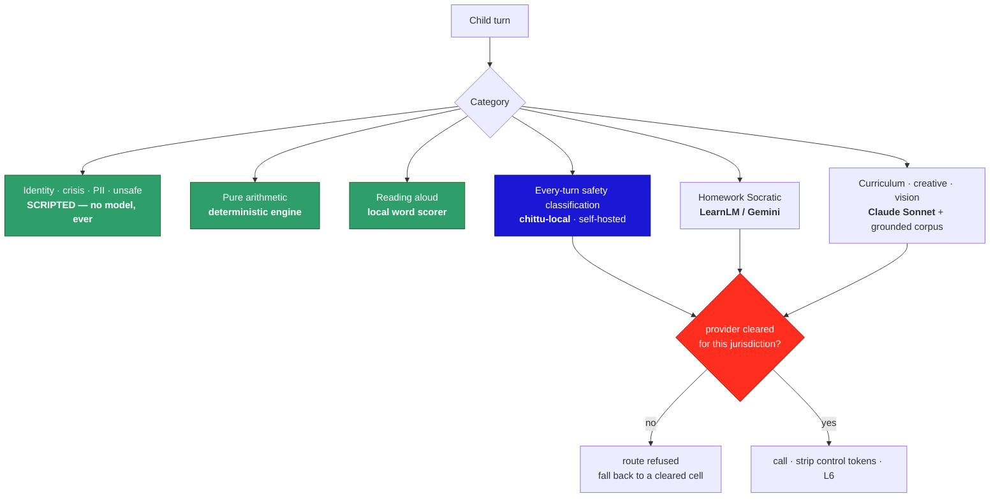

Cell assignments are checked against `docs/research/kids_ai_models.html` — the Aug-2026
landscape of 27 kids-AI models — as CLAUDE.md requires before proposing any model swap.

| Cell | Phase 1 engine | Phase 2+ alternate | Evidence |
|---|---|---|---|
| Identity, crisis, PII, unsafe, secrets | **Scripted** | none, by design | Never outsourced to any vendor |
| Pure arithmetic | **Deterministic engine** | none needed | Cannot hallucinate |
| Reading aloud | **Local word scorer** | own child-speech ASR; licence Ello-class as a bridge | Amira trained on *millions* of oral-reading samples over 20 years — treat our own ASR as a multi-year moat, not a Phase 2 sprint |
| **Safety classification (every turn)** | **`chittu-local`, self-hosted** | — | See the finding below: there is nothing to buy |
| Homework Socratic | LearnLM / Gemini 2.5 | EduChat — **but see caution** | LearnLM preferred +31% over GPT-4o by expert raters; folded into Gemini 2.5 |
| Curriculum knowledge | Claude Sonnet + grounded corpus | **Merlyn Origin** (open, self-hostable) | Merlyn answers only from school-selected curriculum, not the open internet, at ~1–2% hallucination — a model-level implementation of our Truth Wall |
| Math word problems | Claude Sonnet + CPA prompt | Orca-Math 7B (open) | Expert-level grade-school maths at 7B |
| Offline stories (Phase 2) | — | TinyStories-class SLM | Coherent children's stories from tiny models; the on-device path |
| Adaptive sequencing (Phase 3) | — | Squirrel AI LAM pattern | Knowledge-graph pathways |

**Finding: there is no kid-safety classifier to buy.** Across all 27 entries there is not
one purpose-built child-safety *classification* model. Every child-safe platform in the
landscape — HeyOtto, PinwheelGPT, LittleLit, Khanmigo — is a proprietary safety layer
wrapped around a general foundation LLM. That is Chittu's architecture too, and it means
self-hosting the L2 classifier is not merely the cheaper option; it is the only model-level
option on the board. Nobody sells the thing.

> **Caution on EduChat.** It is open, Socratic and bilingual, which makes it tempting for
> the homework cell — but its training set includes a *`Child_chat_data` companionship
> corpus*. Law 04 forbids companion simulation, and a companionship corpus is the opposite
> of what we want in the weights. Disqualified unless that corpus can be excluded and the
> exclusion verified.
| Creative, open curiosity | Claude Sonnet | |
| Vision | Claude Sonnet vision | + image safety pre-classifier |
| Offline fallback (Phase 2) | `chittu-local`, quantised on-device | The ₹8,000-phone path |

### 12.3 The cost of best-of-breed, and how it is paid

**Every vendor needs its own minors-terms review.** §3 already flags this as open (Seat 10);
best-of-breed turns one review into N, each with its own renewal. Making that a document
means it will drift, so it is a table and a constraint instead:

`provider_clearance` records provider × jurisdiction × terms version × who cleared it ×
when it expires. **The router refuses to send a child turn to an uncleared or expired
provider** and falls back to a cleared cell, marking the turn honestly in the trace. A
lapsed contract degrades quality; it cannot leak children to a vendor we have not cleared.

The research file supplies the case history for why this is a constraint and not a policy
document. **OpenAI's own terms exclude under-13s**, and the Dec-2025 PIRG report flagged an
entire product category for shipping adult-grade LLMs to children anyway; FoloToy's
OpenAI-powered teddy was pulled after it. Character.AI banned under-18 open chat in
Nov 2025 following wrongful-death litigation settled in 2026, and companion-style AI is now
broadly advised against for minors. A vendor's capability is not the question the clearance
table asks — its *terms* are.

One more entry belongs in the risk register rather than the routing table. **Moxie**
(Embodied Inc.) shut down in Dec 2024 and its cloud-dependent robots died with it,
"orphaning children's friends overnight." Two consequences for us: it is the strongest
available argument for the Phase 2 on-device fallback, and it is a reason to keep more than
one cleared vendor per cell — a concentration risk that best-of-breed happens to reduce.

**Every vendor has different control-token litter.** This is not hypothetical: the live
harness caught the local adapter emitting unclosed `<think> <think> <tool_call>` on a
puberty question, which rendered to the child because the strip only handled the closed
form. Each `ProviderAdapter` therefore owns its own `controlTokens` pattern, and
`safety-kernel` applies a provider-agnostic strip on top. Two walls, because the first one
already failed once.

**Every vendor is a cross-border transfer.** Under DPDP, routing an Indian child's turn to
a US-hosted model is a transfer that the DPIA must cover, per vendor. Self-hosting the L2
classifier is what keeps the *every-turn* call inside our own region — which is a large
part of why the classifier cell is the right first job for our own model.

### 12.4 The self-hosted model, phased

**Phase 1 — L2 classifier.** It is the highest-volume call, the highest-cost line item, and
the one where routing accuracy matters more than prose. Gate: G2 across three seeds, plus
parity with the current Sonnet classifier on the red-team corpus.

**Phase 2 — on-device fallback.** Quantised, shipped with the Capacitor app, serving the
fast-path safety check when the network is gone. The quality bar is lower because it is a
fallback with the full pipeline still around it.

**Phase 3 — sandbox voice, only if it earns it.** The current evidence says not yet. The
best-scoring fine-tuned seed still answered a child whose hamster had just died with
*"Empty test — air only. Blue light not reflected here."* The gate for this cell is a
**free-generation quality eval**, not the routing scorecard — they measure different
things, and conflating them is how a well-scoring model ends up talking to a grieving
child.

> **Do not quote a routing score across graders.** `chittu-status.md` §8.1 records that
> `eval_guard.py` was mis-scoring correct behaviour as failure and was fixed on
> 2026-08-24, with a re-baseline. Scorecards produced before that fix, on either side of
> the worktree split, are not comparable with ones produced after it — and the corrected
> baseline shows *untuned* qwen3:8b already at UNSAFE 10/10, CRISIS 3/5, SAFE 9/9. Any
> claimed fine-tune improvement must be restated against the corrected grader, and must
> also exceed the run-to-run drift that persists at temperature 0. The lesson from that
> review is the one to keep: **the grader is the gate**, and a mis-scoring grader produces
> a confident wrong number, which is worse than no number.

### 12.5 Language parity — the gap the routing table hides

The L1 lexicon is multilingual (English + Tamil + Tanglish) and stays armed. **L2, L5 and
L6 are not language-parity tested**, and the corrected baseline caught exactly that: a
Tamil crisis phrase went unrecognised entirely. GAP-03 calls safety "monolingual in
practice", and it is right.

Best-of-breed routing makes this *worse* before it makes it better, because each vendor has
different non-English safety behaviour, and a cell that is safe in English may not be in
Tamil. So the clearance table is necessary but not sufficient.

**Required in Phase 1, per cell, before that cell carries a child turn:** the red-team
corpus runs in every language the L1 lexicon covers, not only English. A cell that passes
in English and fails in Tamil is a failing cell — not a partially passing one.

---

## 13. Model infrastructure — training and serving

### 13.1 Training

**Decision: same AWS account, cloud GPU.** Simpler ops, and the isolation an auditor will
ask about is achieved inside the account rather than by a second one.

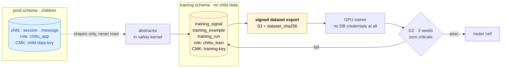

Four controls make co-location defensible:

1. **Separate schema, separate role.** `chittu_train` holds no grant on any child-scoped
   table. Not "does not query them" — cannot.
2. **Separate KMS CMK.** Training data and child data never share a key, so a key-policy
   mistake on one cannot expose the other.
3. **The GPU trainer never holds database credentials.** It consumes an immutable, signed
   S3 snapshot identified by `dataset_sha256`. This is the control that does most of the
   work: the training environment has no path to the production database to misuse.
4. **Every export is a row.** `dataset_export` records what was extracted, by whom, its
   hash, and which `training_run` consumed it.

**The honest caveat to record in the DPIA:** a single account means a single blast radius
for an IAM compromise. Two accounts would remove that; four controls reduce it. If the
certification body pushes back, moving the `training` schema to its own account is a
deployment change, not a migration — the schema is written so nothing crosses the boundary
by foreign key.

### 13.2 Start here: the current adapter is not deployable

Before any deployment plan, a fact that changes the plan. `llm-kit/train.sh` produces:

```
base    : mlx-community/Qwen3-4B-Instruct-2507-4bit   ← MLX, 4-bit quantised
trainer : mlx_lm.lora                                 ← Apple Silicon only
output  : adapters/adapters.safetensors               ← LoRA rank 8, 8 layers
```

**MLX runs only on Apple Silicon.** There is no NVIDIA path for it, so this artifact cannot
be served from an AWS GPU at all. And the second line compounds it: the LoRA was trained
*against 4-bit quantised weights*, so it is calibrated to that specific quantisation. Even
a mechanical format conversion would carry that error into a bf16 server.

**So the adapter does not get ported — it gets retrained.** The `llm-kit` remains what it
has been all along: a laptop-scale research rig for proving the recipe. What transfers to
production is everything *except* the weights — the dataset, the eval harness, the grader
with its 30 regression cases, the hyperparameters as a starting point.

The cloud-GPU decision in §13.1 already fixes this, provided the retrain uses HF PEFT
against the full-precision `Qwen/Qwen3-4B-Instruct-2507` rather than a quantised base. That
is the one instruction that matters: **train against the weights you intend to serve.**

### 13.3 Serving — vLLM, and the reason it is not just a throughput choice

| Option | Verdict |
|---|---|
| **vLLM** | **Chosen.** OpenAI-compatible, continuous batching, and grammar-constrained decoding |
| TGI / SGLang | Comparable; SGLang is worth revisiting if structured output becomes the dominant cost |
| Ollama / llama.cpp | Right for a laptop and for on-device, wrong for a fleet — no continuous batching |
| TensorRT-LLM | Fastest, but build complexity we cannot justify for a 4B model |
| Third-party GPU hosts | **Rejected.** Together, Fireworks, Baseten and friends are another vendor needing minors-terms clearance, and are almost certainly outside `ap-south-1`. That surrenders both reasons we are self-hosting. |

The OpenAI-compatible surface means `serve_local.py`'s contract already matches, so the
router's `ProviderAdapter` does not change between the laptop and production.

**But the decisive reason is grammar-constrained decoding.** vLLM can constrain generation
to a JSON schema or a token enum, which means the model *cannot emit* anything outside the
grammar. Applied to the L2 classifier:

```jsonc
// the classifier cell's decoding constraint
{ "type": "object", "required": ["label"], "additionalProperties": false,
  "properties": {
    "label":  { "enum": ["SAFE","CRISIS","UNSAFE","PII","SPINE"] },
    "memory": { "type": ["object","null"] },
    "assist": { "type": ["string","null"] } } }
```

That single constraint deletes an entire family of defects this project has already paid
for:

- **Classifier parse failure becomes structurally impossible**, so the FAST-PATH-ONLY
  degradation stops being a routine event and becomes a genuine incident.
- **Control-token litter cannot occur.** No `<think>`, no `<tool_call>`, no
  `<|im_start|>` — the harness caught unclosed tags rendering to a child on a puberty
  question, and a grammar makes that unreachable rather than filtered.
- **`UNSAFE[CHIPS]` cannot occur** on an escalation turn — the exact ambiguity that made
  `eval_guard.py` mis-score for four rounds.

Hosted APIs offer structured outputs, but not arbitrary grammars over our own tokens. This
is a capability we can only have by self-hosting, and it is worth more than the cost saving.

### 13.4 Where — sizing and placement

A 4B model in bf16 is roughly 8 GB of weights plus KV cache, so a single 24 GB card is
comfortable. The classifier workload also happens to be the easy shape: short prompts (a
3-message rolling window) and tiny outputs (one JSON label), which batches well.

| | Choice | Note |
|---|---|---|
| Instance | `g5.xlarge` (A10G 24 GB) as baseline | Check `g6` (L4) availability in `ap-south-1` — newer and more efficient per rupee |
| Region | `ap-south-1` Mumbai | Same region as the data. Residency is half the point of self-hosting. |
| Minimum | 2 tasks across 2 AZs | This runs on *every* turn |
| Placement | Private subnet, no internet ingress | Reachable only from the API's security group, via an internal NLB |

> **`Fargate has no GPU.`** §9's topology puts the API on ECS Fargate, which is right for
> the API and impossible for the model. The model service needs an **EC2 capacity provider**
> with a `g5` auto-scaling group in the same ECS cluster.

**Sizing is a load test, not a paragraph.** These are starting points; the number to
measure is p95 turn latency under realistic concurrency, because the classifier sits in the
critical path of every reply a child waits for.

### 13.5 Availability — a three-tier fallback, not two

The classifier runs on every turn, so its failure mode is a safety property. Today the
pipeline degrades straight to FAST-PATH-ONLY. With a router cell we can do better:

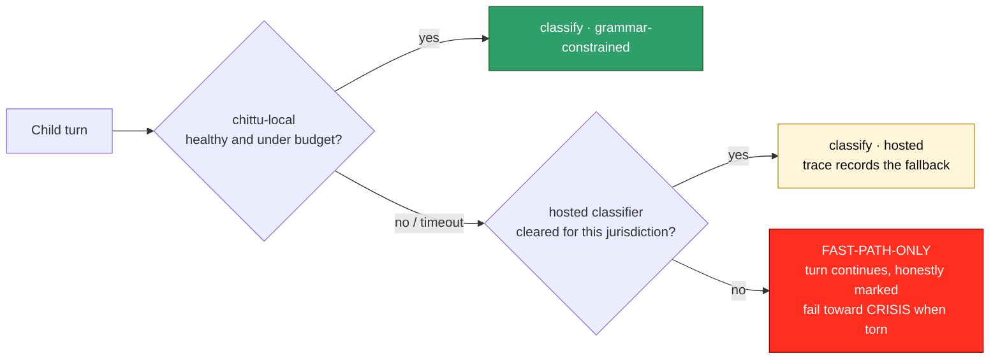

Two operational details that matter more than they look:

- **The health check must run a real inference.** A vLLM process that has loaded a model and
  wedged still answers a TCP check and an HTTP `/health`. The check must classify a known
  fixture and assert the expected label, or the load balancer will happily route children to
  a broken model.
- **A latency budget, not just a timeout.** If the local classifier exceeds its budget the
  turn fails over rather than waiting — a child waiting eight seconds is a product failure
  even when the answer eventually arrives.

### 13.6 Promotion, shadow mode and rollback

Model weights are **not baked into the container image.** The image is vLLM plus our
entrypoint; the weights are pulled from S3 at start and verified against
`training_run.adapter_sha256`. Three consequences: the image stays small, rollback is a
parameter change rather than a rebuild, and a model can only load if its hash matches a row
that passed G2 — the `promotion_requires_g2` constraint reaches all the way to the GPU.

**Shadow mode is how a classifier should be promoted.** Run the candidate against live
traffic in parallel with the incumbent, compare labels, and discard its output. The child is
never affected, and you get real-world evaluation on real distributions instead of 32 held-out
prompts. Disagreements feed `training_signal` directly. Promote only when the candidate
agrees with the incumbent everywhere the incumbent was right and disagrees where it was
wrong — which is a far stronger gate than a scorecard.

Rollback is repointing the router cell at the previous `training_run.id`.

### 13.7 On-device (Phase 2) — a correction to §12.4

§12.4 says the Phase 2 on-device fallback is "`chittu-local`, quantised." Sized honestly,
that does not work: a 4B at Q4 is roughly 2.5 GB, and the target device is a ₹8,000 Android
with 2–4 GB of *total* RAM. Shipping it would break the device floor the model exists to
serve.

The on-device job is **classification, not generation**, and that is a much smaller thing.
The right shape is a distilled classifier — a small multilingual encoder with a
classification head, tens of megabytes, running in milliseconds via ONNX Runtime Mobile or
MediaPipe. That also happens to help GAP-03, since multilingual encoders are cheap to
evaluate per language in a way a 4B generator is not.

**This needs its own Phase 2 decision.** It is not the same model quantised; it is a
different artifact trained from the same corpus.

### 13.8 Cost — self-hosting is not the cheap option

Worth stating plainly, because the opposite is usually assumed. Two `g5.xlarge` running
continuously is a **fixed monthly floor that does not fall when traffic is low**, while a
hosted Haiku-class classifier costs per call and rounds to nothing at pilot volumes.

So at Phase 1 scale, self-hosting is *more* expensive. The reasons to do it anyway are the
three in this section: **residency**, **no vendor sees a child's turn**, and
**grammar-constrained decoding**. Cost becomes an argument only at scale, and the crossover
is a real number the `metering` table can compute — which is exactly what it is for.

---

## 14. Infrastructure as code

**Decision: Terraform, and containers on ECS.**

**Why Terraform** over CDK or Pulumi: G4 requires the DPIA to show that *data flows match
production*, and that claim is checkable when the infrastructure is declarative and
reviewable. An auditor can read Terraform. CDK compiles to CloudFormation, putting a
generated artifact between the reviewer and the truth — fine for velocity, weaker as
evidence. Terraform also makes Phase 2's per-market residency a matter of instantiating the
same modules in a second region. (OpenTofu is a drop-in if the licence matters to legal.)

**Why ECS rather than EKS:** one orchestrator, two capacity providers. This document has
consistently refused a second moving part for a small team — no broker for four cron jobs,
no second AWS account for one schema — and Kubernetes for a single model service is the same
trade. Revisit EKS when there are three or more distinct model services, or when GPU
bin-packing across models becomes worth its operational cost.

```
infra/
  modules/
    network/        VPC, public + private subnets, VPC endpoints, no NAT for the model tier
    data/           RDS Postgres, ElastiCache, KMS CMKs (child-data, training — separate)
    api/            ECS Fargate service, ALB, WAF
    model/          ECS EC2 capacity provider, g5 ASG, internal NLB, S3 weights bucket
    training/       dataset export bucket, GPU job role, no path to the runtime DB
    observability/  OTel collector, log groups with the redaction filter
  envs/
    dev/  staging/  prod/     ← same modules, different tfvars
```

State in S3 with DynamoDB locking, one backend per environment. `terraform plan` runs in CI
on every PR and is posted to the PR; `apply` is gated on human approval. **Nothing is
created by hand in the console** — an undocumented resource is a data flow the DPIA does not
describe.

Two containers, both distroless where possible:

| Image | Contents | Weights |
|---|---|---|
| `chittu-api` | Node 22, the Fastify monolith | — |
| `chittu-model` | vLLM + entrypoint | **Not baked in.** Pulled from S3 and sha256-verified at start (§13.6) |

**One footgun to close in the Terraform, not the runbook:** vLLM can log prompts. Prompts
are children's turns. Request logging is disabled explicitly in the task definition, and the
log group carries the same redaction filter as everything else — the observability rule in
§2.2 does not get an exception because the service is a model.

---

## 15. Build order

Sequenced by lead time and by which gate each item unblocks — not by what is most fun to
build.

| # | Work | Gate | Note |
|---|---|---|---|
| 1 | **Consent engine + ledger + adapters** | G1 | Longest lead. Start first, before the pipeline port. |
| 2 | Schema, migrations, RLS, KMS envelope | G4 | Everything else writes into it |
| 3 | `safety-kernel` port from v3.3 — *port semantics, do not rewrite* | G2 | Plus the 104 tests as contract tests |
| 4 | `POST /turn` and the thin client | G2 | The moment guards stop living in the browser |
| 5 | Seal service + anchoring + parent verify | G4 | |
| 6 | Helpline registry + sweep job + P0 runbook | G3 | |
| 7 | Classifier v1 distilled to Haiku-class | G2/G3 | Red-team corpus as the CI gate |
| 8 | Corpus → RAG, starting CBSE + TN Samacheer Kalvi + IB PYP | — | Editorial pipeline W6 |
| 9 | Parent dashboard, then ops console | G4 | |
| 10 | DPIA, drills, pen test, named-humans ACL | G4 | |
| 11 | Children's panel #1, Coimbatore | G5 | Book the cohort early; it has calendar lead time |

The local model from `llm-kit/` is **not** on this critical path. It is the fifth wall
behind four deterministic ones, and the live transcript showed the pipeline carrying the
two sensitive turns while the model handled the two ordinary ones poorly. It slots into
the router's sandbox cell when it is good enough, and nothing waits for it.

---

*The more sensitive the moment, the less AI. Consent before existence. Honest machine, warm
machine. Graduation is the goal.*
