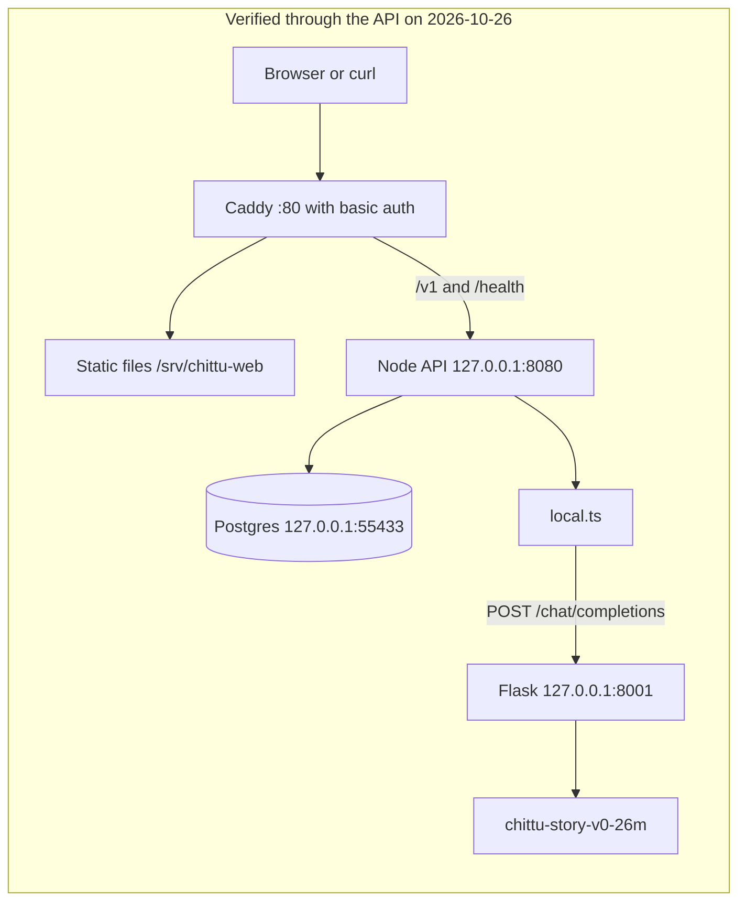
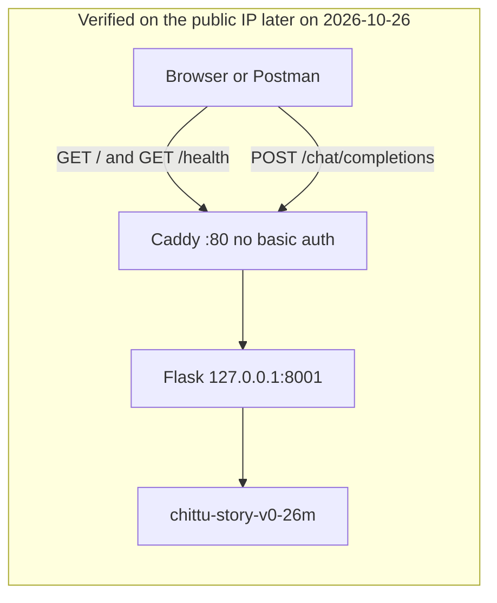

# Chittu proof-of-concept architecture

| Field | Value |
|---|---|
| Document version | 0.1 |
| Prepared | 2026-10-27 |
| Application revision | `0.1.0`; deployed commit pending (no `.git` on the instance) |
| Model revision | Disk revision pending. Harness pin `4f11284f8ebc19348ce2885bfea66eb13c8717cc` is not a verified download hash. |
| Environment | EC2 `i-0f99f1c94ff3ff3e6`, `ap-southeast-2a` |
| Author role | Deployment audit |
| Reviewer | Pending |
| Approval status | Draft |

## 1. Repository inventory

Only files that change how this proof of concept is built, configured, routed, or operated are listed. Test files are omitted unless they define a contract.

| Path | Purpose | Affects |
|---|---|---|
| `package.json` | Root scripts. `build` compiles packages and apps. `start` runs `scripts/dev.sh`. Package manager pin `pnpm@11.9.0`. | Build, runtime |
| `pnpm-workspace.yaml` | Workspace members `packages/*` and `apps/*`. | Build |
| `pnpm-lock.yaml` | Locked dependency tree. | Build, supply chain |
| `apps/web/package.json` | `@chittu/web`. `build` is `vite build`. Dependencies are Preact, not React. | Frontend build |
| `apps/web/vite.config.ts` | Dev server port 5173. Dev proxy sends `/v1` and `/health` to `localhost:${PORT:-8080}`. Production build has no dev proxy. | Dev routing, build |
| `apps/web/dist` | Vite output. Not committed. On the instance it was produced on 2026-10-26 and copied to `/srv/chittu-web`. | Frontend runtime, when Caddy serves it |
| `apps/api/package.json` | `@chittu/api`. `dev` uses `tsx`. `build` emits `dist/` with `tsc`. | API build |
| `apps/api/src/main.ts` | Process entry. Loads `.env.local`, chooses the router, listens on `PORT` (default 8080) and `HOST` (default `127.0.0.1`). | Runtime, safety boot checks |
| `apps/api/src/server.ts` | Fastify routes under `/v1` and `GET /health`. | API contract |
| `apps/api/src/providers/local.ts` | OpenAI-shaped client. Posts to `{CHITTU_LOCAL_BASE_URL}/chat/completions` and `{base}/embeddings`. | Model integration |
| `apps/api/src/providers/cells.ts` | `CHITTU_CELL_*` overrides. Catalogue allow-list. | Routing, safety |
| `apps/api/src/providers/router.ts` | `DEFAULT_CELLS`. Classifier, sandbox, homework, curriculum, and vision default to Anthropic. Embedding defaults to local `mxbai-embed-large`. | Routing |
| `apps/api/Dockerfile` | Production image. Not built on this box. | Intended production runtime |
| `.env.example` | Names of provider, database, KMS, Didit, and ops variables. No real values. | Configuration |
| `deploy/demo/compose.yaml` | Demo stack: Postgres, migrate, API on `127.0.0.1:8080`, `NODE_ENV=development`. | Intended demo runtime. Not the process manager used on this x86 box. |
| `deploy/demo/Caddyfile` | Hostname `chittu.tulifo.ai`, basic auth, `/v1` and `/health` to port 8080, static files from `/srv/chittu-web`. | Intended public edge. Superseded on this box. |
| `deploy/demo/.env.example` | Demo secrets names, including `CHITTU_DEV_MASTER_KEY`. | Configuration |
| `compose.yaml` | Dev Postgres on host port 55433. The server copy was edited to bind that port to loopback. | Data |
| `db/migrations/0001`–`0009` | Schema. Nine files were already applied on the volume. | Data |
| `infra/envs/demo` | Terraform for a different, arm64 demo instance. | Not this deployment |
| `infra/README.md` | States that the Fargate/RDS production stack has never been applied. | Scope |
| `docs/runbooks/demo-deploy.md` | Runbook for `chittu.tulifo.ai` on `13.205.39.18`. | Different environment |
| `llm-kit/compare/compare/systems.py` | Names `Tulifo/chittu-story-v0-26m` and a revision pin. | Model identity, not the running loader |
| `~/chittu-story-api.py` on the instance | Flask wrapper. Not in the git workspace. | Model HTTP contract |
| `~/chittu-story-v0-26m/load.py` | Loads weights without pickles. Imports `nanochat.gpt`. | Model runtime |
| `/etc/systemd/system/chittu-story.service` | Story process. | Operations |
| `/etc/systemd/system/chittu-api.service` | API process. | Operations |
| `/etc/caddy/Caddyfile` | Public edge. Final verified behavior was a reverse proxy to port 8001. | Public exposure |

## 2. Two request paths that were both observed

The first path was verified through the API on loopback, with a consented turn, on 2026-10-26. The second path is what answered the public IP later the same day.

Solid lines in the second diagram were confirmed by HTTP responses (`Via: 1.1 Caddy`, `Server: Werkzeug`). The Chittu API, Postgres, and the safety pipeline are not on that path.

On 2026-10-27 the public IP did not accept connections from the audit workstation. Which diagram is still running was not rechecked.

## 3. `CHITTU_LOCAL_BASE_URL`

`apps/api/src/main.ts` reads `CHITTU_LOCAL_BASE_URL`. If it is non-empty, `main.ts` constructs `localAdapter({ baseUrl })`.

`apps/api/src/providers/local.ts` strips a trailing slash and posts to:

- `{baseUrl}/chat/completions`
- `{baseUrl}/embeddings`

The comment in `.env.example` shows Ollama-style bases that already include `/v1`, because those servers mount the OpenAI routes under `/v1`. The value deployed in `.env.local` was `http://127.0.0.1:8001`, with no `/v1`. That matches the Flask routes, which are `/health`, `/chat/completions`, and later `/`. A base of `http://127.0.0.1:8001/v1` would call a path the wrapper does not implement.

The adapter sends JSON `model`, `max_tokens`, and `messages`, including a system message. The Flask wrapper reads the latest user message and `max_tokens`. It does not read `model`. It clamps `max_tokens` to the integer range 1–200. Temperature 0.6, top-k 50, and seed 42 are fixed in the wrapper. The adapter's timeout default is 60 seconds.

There is no streaming. Time to first token is not available.

## 4. Does a Chittu turn reach this model?

A healthy `/health` response does not prove it. The following observation does.

On 2026-10-26 a direct `POST` to `127.0.0.1:8001/chat/completions` and a consented `POST /v1/session/:id/turn` on `127.0.0.1:8080` returned the same opening: "Once upon a time, there was a brave little sparrow. He lived in a small village near a big hill." The turn trace was:

`SANDBOX (Law 05) · FAST-PATH-ONLY · CORPUS UNAVAILABLE`

Layers reported included `L1_LEXICON`, `L2_CLASSIFIER`, `L5_SANDBOX`, and `L6_FILTER`. `FAST-PATH-ONLY` is the pipeline's label when the classifier does not return a usable verdict (`packages/pipeline/src/index.ts`). The boot log said the classifier cell points at Anthropic and no Anthropic adapter was configured. The sandbox text still matched the local model, which is consistent with the logged cell override `sandbox -> local/chittu-story-v0-26m`.

`POST /embeddings` to the Flask process was logged as HTTP 404. The corpus layer therefore cannot retrieve. The product marks that `CORPUS UNAVAILABLE` rather than pretending a retrieval happened. The boot banner at 08:14:51 UTC still said `grounded corpus: ON — local/mxbai-embed-large`, because the embedding cell is wired to the local adapter. "On" meant the port was configured. The turn showed the call failed.

**Second pass, 27 October 2026, source only.** `local.ts` still posts to `{CHITTU_LOCAL_BASE_URL without a trailing slash}/chat/completions` and `{base}/embeddings`. It does not insert `/v1`. The unit test in `local.test.ts` sets its own base to `http://127.0.0.1:<port>/v1`, and `.env.example` shows `http://127.0.0.1:11434/v1`, because those servers mount the routes under `/v1`. The value recorded on the instance was `http://127.0.0.1:8001`. With that value the sandbox call is `http://127.0.0.1:8001/chat/completions`, which is the Flask route. Adding `/v1` to this base would miss it.

`MODEL_CATALOGUE.local` is still `chittu-baseline`, `chittu-baseline-8b`, `mlx-community/Qwen3-4B-Instruct-2507-4bit`, and `mxbai-embed-large`. `chittu-story-v0-26m` is absent. Current source would reject `CHITTU_CELL_SANDBOX=local:chittu-story-v0-26m` and would not print it under `routing overrides IN EFFECT`. The 26 October process printed that line. The server file was not diffed in this pass. SSH to `3.104.224.113` port 22 timed out, so the running tree was not re-read.

Other cells stayed on Anthropic and were unreachable. Pointing those cells at this story model would be a routing change. The story wrapper has no classifier JSON contract and no embeddings. Doing that to "make the warning go away" would drop classification and grounding. It was not done.

## 5. Identity of the model

The wrapper reports `chittu-story-v0-26m` and loads `~/chittu-story-v0-26m` with `load.py` on CPU. `load.py` states that it needs nanochat at or near commit `92d63d4e8bb4df75c3b71618f31ddde2378b2bcd`, plus torch, tiktoken, and safetensors. The nanochat checkout's actual commit was not recorded. The Hugging Face revision of the weight directory was not recorded.

`llm-kit/compare/compare/card.py` states that this model has never served a child and clears none of the gates that would let it. The public page added on 2026-10-26 calls the model directly and does not apply those gates.
